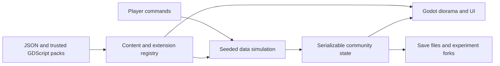

# Courtyard Block

A small place. A shared life.

A playable Godot foundation for experimenting with community life: shape a courtyard, furnish homes, meet residents, run a co-op, and compare alternative ways of living. Built with Godot **4.7.2**, typed GDScript and Compatibility rendering. No npm dependency or browser DOM game layer.

## Play

Open `project.godot` in Godot and press **F5**, or run:

```sh
godot --path .
```

The default game is **An evening back**: 24 neighbours, eight households, and an evening to reclaim. It starts paused. **Inspect** a neighbour's schedule, **Build** a route or service change, **Try** the evening and compare it with the original, then **Workshop** a new service. Read the [playable guide and model limits](docs/evening.md).

Groceries must be collected and cooked. Services have finite stock, opening hours, staffed places, utility requirements and prices. The comparison shows who gains time and who loses it. Workshop includes forms, validated JSON, reusable pack export, and a prompt workflow for an external AI; it does not call a model automatically.

The original 64-resident foundation sandbox is available separately:

```sh
godot --path . -- --foundation
```

That sandbox retains its original save and four bundled packs. Its controls are:

- Drag the world to pan; scroll or pinch to zoom. **Rotate**, Q and E turn the camera.
- **Residents** → choose someone → **Visit their apartment** → add a furnishing.
- **Build** changes the footprint, courtyard, storeys, material or settlement template.
- **Co-op** sets household contributions, shared suppers and shop tenants.
- **Experiments** forks the community. Change a policy, simulate a week, switch branches and run the baseline for comparison. Unlimited funds are optional.
- **Mods** shows installed packs and accepts trusted `.cbmod.zip` files. Restart to activate.
- Space pauses. Every core action also has an on-screen control. Landscape phones use a section dropdown.

Saves are automatic every 30 seconds and on native app suspension/exit. **Save community** saves immediately. The evening's **Try** screen and the sandbox's **Experiments** screen include JSON import/export. They use separate save files. Back up browser saves with Export; private browsing and clearing site storage can remove local data. Missing or changed packs protect existing saves from replacement.

## Develop and validate

```sh
python3 scripts/check.py
godot --path . -- --evening-smoke
godot --path . -- --smoke
godot --path . -- --smoke --benchmark
```

The benchmark uses 150 residents, seven storeys, 5,000 extra batched objects and 10,000 extra catalogue entries. It runs at 20× simulation speed, discards 120 warm-up frames and reports the next 3,600 frames. It never replaces a community save.



The simulation has no scene nodes. Layouts describe navigation graphs and spaces. Static geometry uses MultiMesh batches per floor, material and shape; resident routes are cached. A Rust extension can replace a measured bottleneck later without moving the game rules into rendering code.

See [the evening scenario](docs/evening.md), [modding](docs/modding.md), [foundation model assumptions](docs/model.md), [platform builds and validation](docs/validation.md), and the [foundation checklist](docs/plans/godot-foundation/README.md).

This is a first playable foundation: procedural art, a deliberately small economic model, single-player and trusted local mods. It is not a validated predictor of housing outcomes. Multiplayer, freeform architectural editing, production art/audio, a marketplace, app-store submission and a general custom-mesh importer remain future work.
