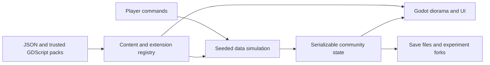

# Courtyard Block

A small place. A shared life.

A playable Godot foundation for experimenting with community life: shape a courtyard, furnish homes, meet residents, run a co-op, and compare alternative ways of living. Built with Godot **4.7.2**, typed GDScript and Compatibility rendering. No npm dependency or browser DOM game layer.

## Play

Open `project.godot` in Godot and press **F5**, or run:

```sh
godot --path .
```

The default game is **Warm homes, shared systems**: a moddable annual community lab with eight households. **Design** a courtyard, detached cluster or elevated settlement; change wall assemblies and shared systems; **Run 90 days** or **Run 1 year**; then inspect household comfort, resource shortages, costs and arrears. Both alternatives use the same weather and households. **Workshop** creates portable material/wall mods, imports hourly weather and packages entire experiments for friends. Start with the [community lab guide](docs/lab.md).

The earlier **An evening back** scenario remains available from the lab's Workshop, or directly:

```sh
godot --path . -- --evening
```

Its groceries, cooking, service queues and personal-time experiments use a separate model and save. Read the [evening guide](docs/evening.md).

The original 64-resident foundation sandbox is available separately:

```sh
godot --path . -- --foundation
```

That sandbox retains its original save and four bundled packs. Its controls are:

- Drag the world to pan; scroll or pinch to zoom. **Rotate**, Q and E turn the camera.
- **Residents** → choose someone → **Visit their apartment** → add a furnishing.
- **Build** changes the footprint, courtyard, storeys, material or settlement template.
- **Co-op** sets household contributions, shared suppers and shop tenants.
- **Experiments** forks the community. Change a policy, simulate a week, switch branches and run the baseline for comparison. Unlimited funds are optional.
- **Mods** shows installed packs and accepts trusted `.cbmod.zip` files. Restart to activate.
- Space pauses. Every core action also has an on-screen control. Landscape phones use a section dropdown.

Legacy-mode saves are automatic every 30 seconds and on native app suspension/exit. **Save community** saves immediately. The evening's **Try** screen and the sandbox's **Experiments** screen include JSON import/export. They use separate save files. Back up browser saves with Export; private browsing and clearing site storage can remove local data. Missing or changed packs protect existing saves from replacement.

## Develop and validate

```sh
python3 scripts/check.py
godot --path . -- --lab-smoke
godot --path . -- --evening-smoke
godot --path . -- --smoke
godot --path . -- --smoke --benchmark
```

The benchmark uses 150 residents, seven storeys, 5,000 extra batched objects and 10,000 extra catalogue entries. It runs at 20× simulation speed, discards 120 warm-up frames and reports the next 3,600 frames. It never replaces a community save.



Both simulation paths have no scene nodes. The annual lab compiles a coupled thermal network from pinned data packs; its UI and renderer consume results. In the original foundation model, layouts describe navigation graphs and spaces. Static geometry uses MultiMesh batches per floor, material and shape; resident routes are cached. A Rust extension can replace a measured bottleneck later without moving the game rules into rendering code.

See [the annual lab and data API](docs/lab.md), [the evening scenario](docs/evening.md), [modding](docs/modding.md), [foundation model assumptions](docs/model.md), [platform builds and validation](docs/validation.md), and the [foundation checklist](docs/plans/godot-foundation/README.md).

For the broader direction beyond the annual slice, read [moddable community experiments grounded in physics and evidence](docs/explorations/0001_[_]_MODDABLE_COMMUNITY_EXPERIMENTS_GROUNDED_IN_PHYSICS_AND_EVIDENCE.md): composable construction and institutions, sourced parameters, reproducible sharing, and year-to-century simulation limits.

This is a first playable foundation: procedural art, a deliberately small economic model, single-player, portable data mods in the annual lab, and trusted local code mods in the legacy sandbox. It is not a validated predictor of housing outcomes. Multiplayer, freeform architectural editing, production art/audio, a marketplace, app-store submission and a general custom-mesh importer remain future work.
