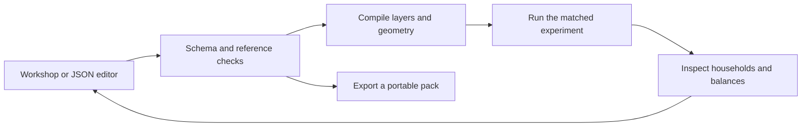

# Create a data mod

The annual community lab uses **API v2**, a JSON-only mod format for the `warm-homes-1` model. A pack can define materials, layered walls, home prototypes, layouts, climates, shared plants, policies and evidence. The built-in content uses the same format.

Start with the **Workshop** in the game. You can also author `manifest.json` in any text editor. Use the [JSON schema](../schemas/lab-pack.schema.json) for field names, units and bounds, and the [independent hemp example](../mods/lab_hemp/manifest.json) for a material, assembly and evidence record together.

## A first pack

This complete manifest adds a thicker timber wall using an existing material:

```json
{
  "api_version": 2,
  "model": "warm-homes-1",
  "id": "my_timber",
  "name": "My timber experiment",
  "version": "1.0.0",
  "dependencies": {"core": "1.0.0"},
  "content": {
    "assemblies": [{
      "id": "my_timber:wall",
      "name": "A thicker timber wall",
      "layers": [{"material": "core:timber", "thickness_m": 0.12}],
      "labor_cents_m2": 5000,
      "evidence": "core:assumptions"
    }]
  }
}
```

Paste it into the Workshop JSON editor, then **Validate & add to this experiment**. Choose the new wall in Design and run the same winter. Here, `core:assumptions` explicitly marks the values as illustrative; it does not establish that this is a buildable real-world wall.

## The contract

- **Namespace:** every definition belongs to the pack, such as `my_timber:wall`. Pack IDs use lowercase letters, numbers, underscores or hyphens. Give variations a new namespace if both should coexist.
- **Dependencies:** references to another pack require an exact version in `dependencies`. Missing or circular dependencies are rejected.
- **Units:** use the schema's units. For a layer, thickness is metres. Conductivity is W/(m·K), density is kg/m³, specific heat is J/(kg·K), and material prices are cents/m³.
- **Evidence:** attach source records with their status, geography, period, license and assumptions. `measured` is an author's claim; the game does not independently verify the source.
- **Validation:** unknown fields, missing references, out-of-range numbers and invalid geometry fail before changing the active experiment. Assembly mass is checked against declared support capacity.



## Package and validate outside the game

Save the manifest in a folder, then run these commands from the repository root:

```sh
python3 scripts/package_mod.py path/to/my_timber
godot --headless --path . --script scripts/run_lab.gd -- \
  --validate-pack=exports/mods/my_timber-1.0.0.cbmod.zip
```

An API v2 `.cbmod.zip` contains only `manifest.json`. Packaging checks the archive shape; the game compiler performs full semantic validation. The pack installs into the current experiment, not a global catalog. An exported experiment embeds its packs and hashes, so friends receive the actual inputs.

## What can an experiment change?

The [community lab reference](lab.md#what-can-be-composed-today) lists every supported definition and its limits. New material values flow into the same heat, mass, cost and resource calculations. A new name does not introduce a new physical mechanism: a tree-house pack does not simulate tree growth, and an earthship pack does not introduce an earth-contact or moisture solver.

For real measurements, follow the [evidence and weather workflow](lab.md#ground-an-experiment-in-data). Keep source licenses with redistributed data. Compare against an independent observation or analytical case before claiming calibration.

Arbitrary scripts, network assets and native libraries are outside this portable format. The earlier sandbox has a separate [trusted-code API v1](modding.md). Ideas for richer future mod capabilities belong in the [moddability design notes](explorations/0001_[_]_MODDABLE_COMMUNITY_EXPERIMENTS_GROUNDED_IN_PHYSICS_AND_EVIDENCE.md).
