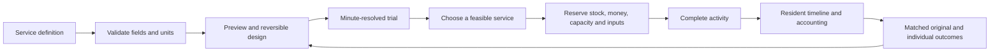

# An evening back

The evening scenario is a playable food-access experiment for 24 residents in eight households. Open it with `godot --path . -- --evening` or from the annual lab’s Workshop. The [annual lab](lab.md) is now the default game. It runs from 16:00 to 22:00, starting paused. The original sandbox remains available with `godot --path . -- --foundation` and retains its four bundled packs and separate save file.

## Play the loop

1. **Inspect:** meet a neighbour, inspect their work schedule, and watch actual travel, shopping, cooking and service events appear in their timeline.
2. **Build:** preview a market footpath, later grocery hours or a service in a ground-floor room. Combine ideas, choose another room, or undo. No money is spent until the trial starts.
3. **Try:** watch the six-hour evening or fast-forward. The original arrangement runs independently with matching people, seed, starting funds and time horizon. Compare individual outcomes as well as totals.
4. **Workshop:** remix capacity, hours, stock and price through a form, or paste a validated JSON service. Try the prototype, export a `.cbmod.zip`, or export a prompt for an external AI.

**Try another idea** restores the same starting population and resources, retaining the current design and up to eight previous reports. **Start a fresh evening** starts over and backs up the previous saved evening. The main outcome is people having at least 45 minutes in the courtyard after dinner during its 19:30–21:00 activities. This deliberately narrow metric is labeled in the game; it is not total free time or a general measure of human flourishing.

## Implemented rules

| System | Behavior |
| --- | --- |
| Households | Three adults per home. One initially collects three grocery portions and cooks for the household. Other members can use meal services independently. |
| Work | Fixed outside work-end times. €80 per person enters the household when work ends. These are synthetic scenario values, not calibrated wages. |
| Grocery access | Grocer closes at 18:30, or 20:00 with an extension. Outside travel is 28 minutes, or 12 with a footpath, plus local route distance. A later market costs more and takes longer to reach. One household has a slower walking pace. |
| Food | Finite stock, purchase prices, opening windows, session duration and simultaneous capacity. A grocery purchase provides three portions; home preparation takes 25 minutes, then eating takes 15. No automatic food recovery at home. |
| Staffing | A resident prepares and staffs each selected local staffed service. Jules covers extended grocer hours. Preparation reserves 15 minutes; wages of €15/hour transfer from shared funds to the worker's household. Staff cannot also shop or cook during a shift. A meal-service worker can buy remaining food at shift end. |
| Money | Purchases, outside wages, local sales, construction, imported food, shift wages, utility charges and collection have explicit accounting. Local transfers do not create money. |
| Utilities | The six-hour scenario starts with 120 L water, 12 kWh electricity and 120 L wastewater removal capacity. Connections can be disconnected while designing. Operations reserve their inputs and output capacity when starting. Water/wastewater each cost €0.005/L, electricity €0.28/kWh, rounded up per operation. |
| Waste | Five kilograms of storage. A scheduled €12 collection at 21:00 clears it if enabled and affordable. If outputs cannot be stored, an activity cannot start. |
| Comparisons | The same 24 resident IDs remain visible. Construction, net operating cost, household food spending, travel, cooking/shift labor, courtyard time and energy are reported separately. |

The outside grocer and market aggregate their own upstream utilities and workforce into their prices; their off-site footprints are not part of the on-site energy total. Consequently, lower measured on-site energy does not demonstrate a smaller total environmental footprint. The collection fee is a contract price. There is no invisible replenishment of local opening stock.



The host still advances in fifteen-minute presentation steps, but the scenario resolves each simulated minute. With 24 residents the work is bounded; it does not instantiate scene nodes for activities or ask an LLM for decisions. The controller advances at most eight scenario steps and two original-arrangement steps per frame. Original and intervention states are independent. JSON saves retain in-progress activities, stock and reservations.

## Service packs and the workshop

The [shared kitchen](../content/evening/manifest.json) and [grocery pickup lockers](../mods/grocery_pickup/manifest.json) are declarative `evening_services` definitions. The locker pack has no entry script. An additional definition of either supported activity type needs no new host dispatch case. Definitions specify minutes after midnight, integer cents, portions, liters, kWh and kilograms; see `CBEvening.SERVICE_FIELDS` and `definition_error` for the bounded schema.

This is an extension to pack API v1, **not the complete proposed API v2**. The current vocabulary supports `groceries` and `meal`; entirely new activities, mobility modes, household structures and institutions still need new engine contracts. Unknown fields and invalid quantities are rejected. Only one extra local service is placed in this scenario; the workbench is a deliberately small test of the composition model.

Workshop prototypes are stored in the save as `workshop:prototype`. Their schema is revalidated on import. Exported packs use `my_evening_pack:service`; authors should change the manifest namespace/version when maintaining multiple distinct packs. Pack exports contain a single manifest, so all definition content participates in the existing manifest fingerprint. Installed packs activate after restarting, and changed pack sets require a fresh evening. Existing incompatible saves remain protected.

**AI support is a prompt/export/import workflow.** The game can export its supported schema and an editable example for a preferred external AI. It can validate and try the returned JSON. There is no integrated model provider, API-key storage, automatic network request or claim that generated parameters are true. Form editing and simulation are offline. The trusted GDScript installer remains a separate code execution path with application capabilities; the data editor does not execute pasted scripts.

## Saves, views and controls

- Evening autosaves use `user://evening.json`; foundation saves continue using `user://community.json`.
- Loading an evening pauses it. Time does not advance while the app is closed.
- Narrow portrait windows use a collapsible bottom inspector and retain floor controls. Landscape windows separate floor and time-control rows. Native mobile orientation follows the sensor; see [Godot's orientation enum](https://docs.godotengine.org/en/stable/classes/class_displayserver.html#enum-displayserver-screenorientation).
- Pan, zoom, rotate, select residents, and change floors with the existing controls. On the ground floor, click/tap a room to choose the proposed service location, or use the room dropdown.
- The service's tables or lockers and its footprint appear in the world. A preview is labeled until the evening starts.

## Implementation and verification

- [x] Minute-resolved food service, stock, utility and staffing model with causal events.
- [x] Independent JSON grocery pickup pack and validated custom prototypes.
- [x] Inspect, Build, Try and Workshop screens, reversible designs, automatic reference trial and resident comparisons.
- [x] Separate evening saves, protected original sandbox and deterministic mid-service continuation.
- [x] Headless simulation/accounting tests and actual scene/controller checks in `scripts/check.py`.
- [x] Native desktop and portrait rendering smoke checks; browser build, intervention and comparison exercised.
- [ ] Observe new players to evaluate enjoyment, understanding and strategy balance.
- [ ] Validate physical phone interaction, thermal performance, safe areas and the unresolved iOS runtime path.
- [ ] Add additional settlement topologies, general activity planning, access modes and institutions using the broader exploration.
- [ ] Add general bathroom/sanitation routines, physical pipe networks, ongoing deliveries, care, noise and multi-day life simulation.
- [ ] Add an integrated optional AI provider and transactional migrations for changed pack sets.

```sh
python3 scripts/check.py
godot --path . -- --evening-smoke --screenshot=artifacts/evening-desktop.png
godot --path . --resolution 390x844 -- --evening-smoke --screenshot=artifacts/evening-phone.png
godot --headless --path . --export-debug Web exports/web/index.html
python3 scripts/serve.py
```

The architecture and wider design remain in the [gameplay exploration](explorations/0000_[_]_COMPOSABLE_COMMUNITY_MECHANICS_AND_PLAYFUL_EXPERIMENTS.md). This first scenario supplies a testable loop; it does not yet establish a general model of every living arrangement.
