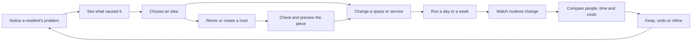
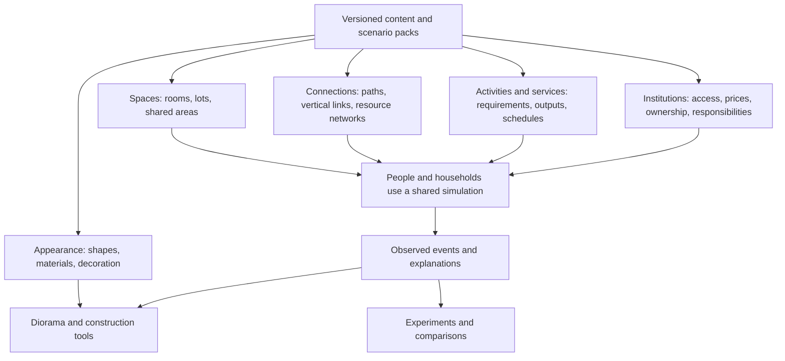

# 🧩 Courtyard Block: composable communities and playful experiments

**Status:** Design exploration with a first playable slice implemented. See [the evening guide](../evening.md) for exact scope and remaining work; the broader design remains proposed.

**Date:** October 2, 2026.

**Direction from the user:** Accessible, engaging problem solving with meaningful skill progression. Encourage experiments and mods, including AI-assisted creation, so players can explore living arrangements the original developers never anticipated. Success is discovering better solutions and better models; there is no required final victory or defeat.

## Executive summary

**Make the central activity “notice a problem, understand it, try an idea, watch lives change.”** The construction toy gives players something satisfying to manipulate. Residents give decisions meaning. The simulation supplies consequences, and the experiment tools make surprising results worth investigating.

The fundamental unit of gameplay should be a **daily-life problem with several plausible solutions**. A parent misses dinner because work, shopping and travel fill the evening. A communal kitchen might help, but so might a closer shop, different opening hours, food delivery or better transport. Each option consumes different combinations of space, money, materials and other people's time. Players learn to see those relationships and gradually invent solutions of their own.

Recommend six connected mechanics:

1. **Follow a life:** inspect a resident's day and trace an unmet need to its causes.
2. **Compose a place:** snap together homes, useful rooms, outdoor areas and connections.
3. **Organize services:** choose schedules, staffing, prices, access and shared responsibilities.
4. **Balance resources:** manage time, money, stock, infrastructure capacity and maintenance.
5. **Run an experiment:** fork the community, try alternatives, compare who benefits and what it costs.
6. **Invent a piece:** remix or create a mod, test its behavior, then use it in the same loop.

Start with one excellent evening-food problem, not a complete city simulation. Prove that three solutions are enjoyable and understandable, and that a fourth can be added by a content pack without changing the host simulation. Then extend the same service contracts to sanitation, waste, mobility, care and other needs.

## 🔎 Current state in the repository

The following are observed implementation facts. Recommendations elsewhere in this document are design proposals.

| Existing foundation | What it already enables | Gap relevant to play |
| --- | --- | --- |
| [Scene-independent simulation](../../core/simulation.gd), deterministic random state, JSON saves | Repeatable communities with up to 150 residents | Fixed daily schedules and four hardcoded needs; little adaptation to individual circumstances |
| [Spatial routing](../../core/spatial.gd) and procedural building generators | Residents move between spaces; alternative geometry is possible | Fifteen-minute simulation steps and minimum journey duration obscure short-distance differences; `city` and `courtyard` are mandatory destinations |
| Furnishing, shop leases, contribution and shared-meal controls | Immediate building and management interactions | Furniture adds comfort regardless of its descriptive need; eating at home restores food without consuming household stock |
| Service expenses and reliability | Utilities have a budget consequence | Water, sewage, power and waste share a financial reliability model; no actual pipes, capacity allocation, toilets, storage or collection routes |
| Households, wallets, business wallets and daily settlement | Money can enter, circulate and leave the modeled community | Resident income is assigned independently of real local payroll; business performance uses synthetic external trade |
| [Save forks and matched-hour comparison](../../core/saves.gd) | A starting point for experiments | Two manual branches, aggregate outcomes, no complete explanation of changed behavior or controlled external event streams |
| [Content and callback registry](../../core/catalog.gd), four example packs | JSON items, generators, visuals, scheduled effects and text panels | The generic registry does not make the core activity planner or need dimensions generic |
| [Godot interface](../../ui/interface.gd), cutaways, resident selection, mobile layout | A playable native/browser foundation | Feature tabs dominate; no integrated problem → cause → intervention → comparison flow |

The [model assumptions](../model.md) accurately identify much of this simplification. In particular, `CBSimulation._update_person`, `_settle_day`, `_apply_effects` and `CBValidation.layout_error` contain assumptions that new geometry alone cannot replace. Rebuilds also constrain buildings to five–seven floors. A village appearance therefore does not yet establish a village economy or way of life.

The [validation record](../validation.md) reports 550 passing checks and measured desktop/browser frame-time targets under the current synthetic load. Those are useful baselines, not evidence that richer service queues, large mod behavior sets or physical phones meet the same targets. Physical phone performance remains untested and iOS runtime validation is incomplete.

## 📚 External research and its implications

These sources inform design patterns, not the correctness of our social model. The Cities: Skylines II articles describe the developer's 2023 intended design; they are not verification of every behavior in the current game.

| Primary source | Relevant observation | Our inference for Courtyard Block |
| --- | --- | --- |
| [Cities: Skylines II: Citizen Simulation & Lifepath](https://www.paradoxinteractive.com/games/cities-skylines-ii/features/citizen-simulation-lifepath) | The developer connects individual activities to travel, service use and life events, and provides ways to follow citizens. | At our smaller scale, a resident's day can be the main explanation interface. We should derive stories from actual events. |
| [Cities: Skylines II: Economy & Production](https://www.paradoxinteractive.com/games/cities-skylines-ii/features/economy-production) | The described household decisions connect destination travel, remaining time, expenses and service access; businesses participate in resource flows. | Time and affordability can connect our systems, while explicit outside providers keep a small community from needing every industry on site. |
| [Factorio: Data lifecycle](https://lua-api.factorio.com/latest/auxiliary/data-lifecycle.html) | Mod definitions and runtime behavior have distinct lifecycles, ordered dependencies and explicit handling of configuration changes. | Separate pack compilation from simulation execution. Version definitions, record ownership and make migrations an explicit operation. This does not imply copying Factorio's Lua architecture. |
| [Apple: Design advanced games for Apple platforms](https://developer.apple.com/videos/play/wwdc2024/10085/) | Apple recommends device-appropriate layouts, comfortable type and controls, including default 44 × 44 point touch targets on iPhone/iPad, and testing on devices. | Adapt the inspector and construction gestures to touch instead of shrinking the desktop interface. Godot logical pixels need device-scale verification. |
| [Godot: General optimization tips](https://docs.godotengine.org/en/stable/tutorials/performance/general_optimization.html) | Godot emphasizes measurement, performance-conscious architecture and profiling on different hardware. | Keep the engine choice; measure event scheduling, routes, history and mod workloads before deciding whether a particular kernel needs Rust. |
| [Schell Games: Playtesting](https://schellgames.com/playtesting) | The studio distinguishes testing enjoyment and the player experience from repeatable bug-focused QA. | Determinism and frame-time checks cannot establish that this loop is fun. Observe players making and revising hypotheses. |

## 🎮 The playable loop



### A concrete evening

Maya finishes work late. Shopping and getting home consume the evening, and she repeatedly misses an activity she wants to attend. Selecting her shows a timeline: work, travel, shop queue, cooking, remaining time. The missed activity links to the events that prevented it.

The player can shorten the route, open a nearby shop later, arrange a grocery pickup service or establish a shared kitchen. These are different strategies, not four price tiers of the same upgrade.

Opening later needs another shift. The shared kitchen saves preparation time for diners but needs ingredients, sanitation, space and somebody's labor. A shortcut is inexpensive to operate but only helps people who can use it. The player sees estimates before building and observed results afterward.

The satisfying moment is visible: Maya gets home in time and joins the activity. Another resident now works the late shift, so the comparison also shows that person's evening. The next idea might be rotating shifts or changing opening hours again. A successful design creates a new possibility to explore, not an endless stream of mandatory emergencies.

All characters, situations and quantities in examples are illustrative, not current simulation results.

### What makes that fun

| Source of enjoyment | Concrete mechanic |
| --- | --- |
| Making something | Snapping a room into place, drawing a path, furnishing a shared space, seeing it become occupied |
| Solving a puzzle | Finding that a service is nearby but closes too early, or that an accessible route changes who can use it |
| Caring about people | Following a few recognizable residents with different aspirations and seeing their routines improve |
| Discovering combinations | A shared kitchen makes evening childcare practical; that changes which work schedules are possible |
| Expressing a preference | Choosing a quiet community, busy mixed-use block, multigenerational cluster or another personally meaningful arrangement |
| Becoming more capable | Predicting a bottleneck, diagnosing a side effect, designing an experiment, making a reusable solution |
| Contributing something | Packaging a useful invention so another player can adapt it |

Positive opportunities matter as much as problems: a resident proposes a repair workshop, an unused room becomes a music space, or a thriving grocer can support delivery. Include breathing room to decorate, observe and enjoy a functioning community.

### Skill progression without a compulsory win condition

Progression should primarily be **player mastery**, supported by short optional challenges and a growing notebook of discoveries and blueprints.

| Stage | New skill | Example task |
| --- | --- | --- |
| Notice | Connect an outcome to a cause | Find why one household keeps missing dinner |
| Adapt | Change one variable deliberately | Test a route or opening-hours change |
| Balance | Anticipate who pays and who benefits | Improve food access without overloading kitchen staff |
| Investigate | Compare alternatives and unexpected effects | Test a quiet courtyard against an active courtyard at the same budget |
| Compose | Build a reusable pattern | Save a staffed, supplied kitchen and its operating schedule as a blueprint |
| Invent | Add a missing possibility or model a missing relationship | Create a grocery pickup service or an acoustic-screen component |

Introduce tools when they are useful; experienced players can access them immediately. Basic sanitation, pause, undo and experimentation must not require grinding. Optional scenario constraints provide challenge: limited space, a fixed operating budget, a particular household mix, or resilience to a chosen disruption. Avoid compulsory bankruptcy resets; a struggling community remains recoverable through redesign, outside support or an explicitly recorded experiment grant.

## 🏘️ The primary systems

### Daily life: time, access and choice

Each person has a finite day, commitments, preferences and access constraints. They choose among feasible activities. A facility helps when a person can reach it, afford it, use it at the right time and obtain a place or the required supplies.

**Time is a connective measure, not the only measure of value.** Separate unavoidable overhead from activities a resident chooses and values. Caring for a relative, cooking together or walking for pleasure should not automatically be classified as wasted time. Someone may prefer privacy to a shorter shared meal, or a longer enjoyable walk to a faster expensive trip.

Start with simple inspectable decisions, not a purportedly perfect optimizer. Show the alternatives considered and why they were rejected: closed, inaccessible, too expensive, full, out of stock, or conflicting with a commitment. Household shopping and care can be coordinated so every member does not independently buy identical groceries. A person cannot simultaneously staff a shop, provide childcare and attend a club.

### Needs and the choices they create

The rows below describe an eventual vocabulary, not a requirement to implement every system together.

| Domain | What should actually happen | Interesting choices and tradeoffs |
| --- | --- | --- |
| Shelter, rest and privacy | Sleeping places, usable space, thermal conditions and disturbance affect rest | More homes versus shared rooms; private facilities versus lower shared costs; insulation versus construction expense |
| Food and groceries | Acquire stock, store it, prepare or buy meals, consume it | Local shop, outside market, delivery, shared meals or growing food; price, labor, travel, spoilage and choice |
| Toilets and bathing | Accessible facilities, privacy, clean water where required, waste handling and cleaning | Private bathroom, well-run shared bathroom, accessible public facility, or another sanitation system with explicit inputs and upkeep |
| Water and wastewater | Supply, storage, consumption and treatment/removal respect capacity | Municipal connection, storage, conservation or local treatment; capital cost, reliability and maintenance |
| Electricity and heating | Activities and equipment request energy; supplied capacity and storage limit use | Imported power, local generation, storage, efficient equipment or alternative heat sources; some uses are optional or can be deferred |
| Garbage and clean streets | Waste accumulates at sources and storage points; collection and cleaning need access, time and disposal capacity | Pickup frequency, shared bins, separation, composting, street-cleaning schedules; cost, space, labor, noise and missed pickups |
| Work and household economy | Jobs need staffed hours; wages, sales and operating expenses have counterparties | Local employment versus outside work, remote work, opening hours, contributions and shared purchases |
| Health and pharmacy access | Routine needs and appointments require reachable, affordable services and supplies | Local pickup point versus outside pharmacy; delivery, opening hours and mobility; avoid pretending the prototype predicts clinical outcomes |
| Family, care and learning | Household aspirations depend on space, security, time and available care | Childcare, school access, elder support, flexible work and multigenerational homes; care labor is visible whether paid or unpaid |
| Recreation and community | Compatible people need opportunities and overlapping free time; repeated encounters can build relationships | Quiet gardens, clubs, workshops, sport or communal meals; invitations and opt-out, capacity, staff, noise and privacy |
| Mobility and access | Paths, stairs, elevators and transport services connect activities | Walking, cycling, transit and optional cars; step-free access, parking, waiting, fares, service hours and reliability |
| Noise and environmental comfort | Sources operate at particular times; distance and barriers alter exposure | Relocate activities, change hours, improve partitions, add buffers or manage deliveries; density itself is not a universal penalty |

Facilities can be external services. A community of 80 people need not own a hospital, sewage works or bus fleet. Outside connections should have explicit travel time, prices, opening hours and capacity assumptions, instead of becoming cost-free escape hatches. A transit mechanic can start as a stop with a route, timetable, fare and destination; detailed vehicle simulation is a later choice.

For bathrooms, simulate facility availability and use without making the player direct every toilet visit. For plumbing, start with understandable connections and throughput; full hydraulic engineering is optional future mod territory. Automatic connection suggestions keep normal construction easy, with a diagnostic layer for bottlenecks.

### An economy that creates choices

Track three linked budgets: **household money, operator/community money, and people's time**. A subsidized service still consumes labor and supplies. A profitable shop is not automatically a good outcome if residents cannot afford its goods. An unpaid rota still consumes the volunteers' time and must account for participation and commitments.

Record transfers consistently. Local wages debit the employer; outside wages enter from a named outside source. Purchases move money and goods; imports and exports cross an explicit boundary. Freeform mode can relax capital constraints while retaining operating requirements, or allow further rule changes with clear labels. Separate one-time construction cost, ongoing cost and external support in comparisons.

Initially, offer service presets such as affordable, extended-hours and volunteer-supported, with editable detail. The player should not need to set dozens of wages and prices to solve the first problem.

### Well-being and family aspirations

Use a compact overview with access to the underlying dimensions. Show severe unmet needs, time available for chosen activities, cost burden, stability, belonging and the least-served residents alongside averages. A lovely garden should not conceal that a household lacks sanitation.

Residents and households can want different futures: more room, a child, a relationship, independence, a studio, caregiving support or a quieter life. Treat the ability to pursue those aspirations as meaningful. Do not use birth count or a single household form as a universal success score.

Keep the original resident cohort visible when a redesign causes moves. Otherwise a player could apparently improve well-being by displacing everyone who struggles. Report newcomers, departures and their reasons separately. A model's weights and assumptions remain inspectable; no outcome establishes an objectively best settlement form.

## 🧱 The Lego foundation

Separate **appearance**, **spatial arrangement**, **services** and **social rules**. A European facade is an appearance pack. A courtyard is a spatial pattern. A grocery shop is a service. A cooperative lease is an institution. They should combine independently where their requirements are satisfied.



The reusable pieces need these contracts:

- **People and households:** identity, capabilities, preferences, relationships, commitments and shared resources.
- **Spaces:** area, capacity, environmental properties, allowed uses and access boundaries.
- **Connections:** endpoints, modes, access requirements, travel time or resource throughput.
- **Resources:** units, stock, flows, storage, sources and sinks.
- **Services and activities:** eligibility, inputs, staff, duration, capacity, outputs and evidence of completion or failure.
- **Institutions:** who owns, pays, can enter, sets hours, allocates scarce slots and participates in shared work.

Example combinations:

| Arrangement | What uses the same contracts | What changes |
| --- | --- | --- |
| Courtyard block | Homes, paths, shared spaces, utilities and services | Compact access, shared outdoor space, mixed-use frontage |
| Suburb or cul-de-sac | The same households and activities | Plot sizes, route lengths, road/parking costs, outside connections |
| High-rise | The same service and resource requests | Vertical routes, elevator capacity/waiting, service cores and evacuation/access assumptions as modeled |
| Eco-village | The same needs, stock and time budgets | Shared work, local production, storage, imports and alternative resource systems |
| Tipi-based or another culturally specific settlement | Shelter, activities, connections, institutions and resource flows | Pack-authored materials, seasonal context and particular social arrangements; architecture alone must not invent a culture |
| Speculative habitat | Extensible versions of those contracts | Novel resources, activities, constraints and institutions, with their assumptions declared |

Do not encode a technology ladder that makes one of these the automatic endpoint. Compare their consequences under stated climate, prices, household preferences and external services. Low electricity consumption can coexist with substantial fuel use or labor; report the modeled substitutes. Conversely, a style-only change should not magically change income or social connection.

Start authoring with prefabs and room slots. Later offer custom footprints, vertical assemblies and detailed network design using the same underlying pieces. Progressive construction tools should expose depth without requiring it for ordinary play.

## 🧪 Experiments and AI-assisted invention

### Two kinds of experiment

**Change the community:** move a kitchen, adjust a schedule, add a path, change a contribution. Keep the model fixed and compare alternatives.

**Change the model:** introduce an activity, revise a noise rule, change assumptions about care, or add a new sanitation technology. Record a different model/pack version and re-run both the baseline and intervention under it when making comparisons. A mod that merely changes the happiness formula has changed what is measured; it has not demonstrated improved lives under the previous model.

Both are valid and should be welcoming in the UI: “Try a design” and “Remix the simulation.” Explain differences through a short change summary, with technical details available on demand.

An experiment should preserve the starting people, date, environment and external conditions. Compare the same elapsed period, show setup costs separately, and offer several seeds for a more robust comparison. A shared initial random seed alone is insufficient when a change causes different numbers of random draws. Use independently keyed external events, for example by scenario seed, day, entity and event type.

Keep the outcome understandable: who gained time, who lost time, which needs remained unmet, what became expensive, and what new constraint appeared. Label projected effects as estimates and post-run effects as observations. A deterministic simulation comparison establishes behavior in this model, not real-world causation.

### A mod workshop inside the loop

The useful AI feature is **“help me build and test this idea.”** It should operate on concrete definitions, examples and observed evidence.

Example request: “Make a grocery pickup locker that serves residents after the shop closes. It needs deliveries, storage capacity and power for chilled food.” The workshop can draft a service definition, choose compatible visuals, expose a few editable settings and generate tests. The player can see the costs and operating assumptions before trying it in a branch.

```mermaid
sequenceDiagram
    actor Player
    participant Workshop
    participant Assistant as Optional AI assistant
    participant Validator
    participant Trial as Experiment branch
    Player->>Workshop: Describe a new service or remix a piece
    Workshop->>Assistant: Selected evidence, schema and examples
    Assistant-->>Workshop: Draft pack, assumptions and proposed checks
    Workshop->>Validator: Validate definitions and requirements
    Validator-->>Workshop: Errors, compatibility and bounded-cost checks
    Workshop-->>Player: Editable preview and change summary
    Player->>Workshop: Try this version
    Workshop->>Trial: Load a pinned pack version into a copy
    Trial-->>Workshop: Events, outcomes, failures and runtime cost
    Workshop-->>Player: Explain results; revise, keep or export
```

Provide a gradual authoring path:

| Level | Player action | Implementation direction |
| --- | --- | --- |
| Remix | Change appearance, size, price, hours or capacity | Forms over validated definitions; no code required |
| Compose | Combine known facilities and services into a new piece | Declarative requirements, bounded operations and reusable recipes |
| Ask | Describe an idea in ordinary language | Optional AI produces the same inspectable artifacts as the forms |
| Extend | Add behavior the current vocabulary cannot express | An advanced, versioned extension API and developer tools |

The game should say when a proposed idea needs a capability the engine does not have. An AI must not silently substitute “+10 happiness” for a functioning delivery or wastewater system. Feedback should distinguish:

- **Definition error:** missing unit, unknown resource, cyclic dependency or incompatible pack.
- **Operational failure:** no staff, unreachable entrance, exhausted stock or insufficient power.
- **Unexpected consequence:** the new service works but shifts cost or unpaid work to someone else.
- **Model limitation:** the simulation does not represent the mechanism the player wants to test.
- **Performance problem:** the new pack causes too many events, route requests or expensive callbacks.

For novel systems, offer a miniature test scene, adjustable conditions and inspectable outputs. A player can ask, “Should doubling the queue capacity help if staffing is unchanged?” and check the answer. Passing generated tests shows internal consistency, not that AI-invented social assumptions are true. Label parameters as measured, estimated or fictional, with units and sources where available.

### Practical boundaries for the workshop

The portable default should be data and a deliberately bounded rule vocabulary, interpreted by the game without arbitrary filesystem or network access. Limit expression depth, work per event, spawned events and retained state. This is a **new capability to build and verify**, not a property of today's trusted GDScript loader.

Current [API v1](../modding.md) executes trusted code and requires restart after pack changes. It also pins saves to the installed pack set and fingerprints only manifests and entry scripts. Therefore instant safe previews and existing-save migration cannot be promised by wrapping today's loader in a chat box. Initially, draft and validate a pack, then open a separate trial community using a pinned pack set; retain the original unchanged. Add transactional migration only with explicit validation and rollback.

Keep AI optional and outside simulation ticks. Ordinary play, inspection and form-based remixing should work without a model call. Use selected diagnostic context for an assistant; make any provider-bound data and metered generation visible. Treat generated content as an untrusted draft. Publishing is a separate player action. Advanced script support and distribution policies require platform-specific work; the common data format is the first cross-platform target.

## 👆 Intuitive on desktop, web and mobile

Organize ordinary play around three actions: **Inspect, Build, Try**. Management controls appear on the relevant service, resident or shared budget rather than requiring knowledge of an abstract tab hierarchy. Add a visible Workshop entry as players start remixing.

| Interaction | Desktop/web with pointer | Phone/tablet with touch |
| --- | --- | --- |
| Inspect | Click a resident, room or problem | Tap; resolve crowded selections with a short nearby-items list |
| Pan and zoom | Drag/wheel plus visible controls | One-finger background drag, pinch, and visible zoom controls |
| Place a piece | Ghost preview, snap, rotate, confirm | Tap a target, adjust with large controls, confirm; avoid finger-covered precision |
| Read details | Side inspector beside the world | Collapsible bottom sheet, with landscape adaptation and a clear return to the scene |
| Change floors | Visible floor selector | Same labeled control with large targets; no required hidden gesture |
| Compare | Two views or a before/after toggle | Before/after toggle, matched camera and a compact outcome card |

Hover, right-click, keyboard shortcuts, rotation gestures and drag-and-drop can accelerate use but must not be the only path to an action. Use text and icons as well as color, scalable text, reduced motion, predictable focus and descriptions that remain available when paused. Target roughly 44–48 logical touch units after platform scaling, then verify on actual devices; a nominal Godot button size is not physical-device proof.

Use a beautiful normal view with optional lenses for daily routes, service access, utilities and noise. Reveal pipes when diagnosing pipes. Avoid covering the world in permanent numbers. Show a few grouped, actionable problems; recurring sanitation failures should not produce one notification per resident per tick.

Each problem card should answer: **what happened, who is affected, why, and what could be tried?** Offer a small set of relevant ideas with tradeoffs, not a guaranteed correct answer. Every explanation links back to events and spatial evidence. “The grocer closed before these residents arrived” is more useful than “food: 41.”

Pause during deliberate design, provide undo for edits, and use forks to recover after simulation time advances. A trial can run quickly and remain cancelable. Closing a mobile session should not cause unrequested offline decline. These affordances lower the cost of experimenting without removing consequences inside a trial.

## ⚙️ Architecture and performance implications

### Extend the foundation in bounded slices

Keep Godot, typed GDScript, serializable state and batched rendering. Introduce an API v2 for the new contracts instead of stretching `need` effects into a universal modeling language. Migrate existing base content first so it proves the public contracts. Keep the v1 prototype available through an explicit compatibility path or an archived save; never silently reinterpret old saves under different rules.

Suggested responsibilities, not files that already exist:

| Boundary | Responsibility |
| --- | --- |
| Definition compiler | Validate IDs, units, references, requirements and bounded rule expressions; build indexes |
| Activity planner | Propose feasible uses of a person's time from preferences and commitments |
| Reservation resolver | Allocate finite stock, money, staff and service slots consistently |
| Event reducer | Apply validated changes atomically to canonical state |
| Network evaluator | Compute travel access and utility supply/capacity; invalidate relevant caches on edits |
| Evidence recorder | Keep bounded records of attempts, failures, transfers and outcomes |
| Experiment runner | Pin scenario/model versions and execute comparable branches |

Prefer pure calculations that return proposals, followed by one controlled mutation boundary. Plan against a consistent snapshot and resolve competing requests before committing effects; otherwise iteration order can determine who always gets the last meal. Use explicit, deterministic allocation policies such as reservations or rotating priority. Access policy itself can become a modeled institution.

### Time resolution and cost

The current fifteen-minute update interval is too coarse to make a two-minute shortcut or a short service queue legible. Introduce integer-minute event timestamps, with activity completions and scheduled service events processed when due. Keep slow ledgers and aggregate reporting on appropriate intervals. Do not replace every fifteen-minute scan with fifteen full scans of everything.

Render movement independently of authoritative activity events. Cache feasible destinations and routes, recomputing on relevant changes. Compile definitions once, aggregate external services, bound detailed histories and update UI summaries only when their inputs change. Avoid deep-copying the entire community per person or per small event; typed read views and explicit deltas can preserve isolation efficiently.

Run comparisons incrementally under a frame budget so a phone can keep responding. Retain deterministic event order even if wall-clock scheduling differs. Track routes, reservations, history memory, pack compilation and construction spikes in addition to steady-state rendering. Treat custom materials and visual diversity as separate costs from primitive count.

Profile before moving a measured bottleneck to Rust. A native extension is an option for a stable hot algorithm, not a prerequisite for the mechanic or an assumption of browser/mobile parity. Keep the current reference load as a regression baseline and add behavior-heavy scenarios; defer claims about weaker hardware until measured there.

Daily play and multi-year household change also need separate pacing decisions. Do not silently make a day both a normal working day and a year of aging. Begin with days/weeks. A later explicit chapter advance must preserve or summarize its financial, care and resource consequences.

### Example: proposed declarative service

**Illustrative API v2 only. This is not loadable by today's v1 loader.** These are synthetic balancing values, not engineering or health guidance. Definitions such as resources and activities referenced below would also be declared and checked by the compiler.

```json
{
  "id": "neighbourhood:shared_kitchen",
  "schema_version": 2,
  "kind": "service",
  "name": "Shared kitchen",
  "space_tags": ["base:food_preparation"],
  "activity": "base:shared_meal",
  "opening_windows": [[1080, 1260]],
  "session_minutes": 30,
  "parallel_places": 8,
  "staff": {"activity": "base:cook_shift", "count": 1},
  "inputs_per_person": [
    {"resource": "base:ingredients", "quantity": 1, "unit": "portion"},
    {"resource": "base:potable_water", "quantity": 2, "unit": "L"},
    {"resource": "base:electricity", "quantity": 0.2, "unit": "kWh"}
  ],
  "outputs_per_person": [
    {"resource": "base:wastewater", "quantity": 2, "unit": "L"},
    {"resource": "base:food_scraps", "quantity": 0.1, "unit": "kg"}
  ],
  "price_cents": 400,
  "requires": ["base:accessible_entrance", "base:working_sanitation"],
  "on_complete": [{"operation": "complete_activity", "activity": "base:shared_meal"}]
}
```

The host resolves paths and time conflicts, reserves a staffed place, money, stock and output capacity, then records a completion. The declared activity determines nourishment and any interaction opportunity. Failed reservations report causes; canceled sessions release held resources according to a defined policy. Power throughput must be derived from energy over the session, rather than confusing kWh with kW. Aggregate consumption must replace, not duplicate, the prototype's daily per-person resource charges.

The same machinery can support a bathroom, pharmacy pickup, music rehearsal or care session with different requirements and outputs. A composting toilet would declare its own sanitation process and servicing needs; it would not be a plumbed toilet with its water cost deleted.

## Options and tradeoffs

| Approach | Strength | Main risk | Recommendation |
| --- | --- | --- | --- |
| Add more objects with stat bonuses | Fast and visually varied | Experiments become finding cheap positive modifiers; behavior remains opaque or shallow | Use for clearly cosmetic/abstract content only, not core needs |
| Build a detailed engineering/city economy first | Broad simulation vocabulary | Long wait for a satisfying loop; difficult phone interface and expensive model complexity | Avoid as the initial path |
| Ship a blank universal simulation workbench | Maximum early freedom | Players must invent both the game and its model; little guidance or attachment | Keep as an advanced mode, grounded in authored examples |
| Build a small service-driven game and extract reusable contracts | Immediate problems, visible outcomes, testable extension points | Early assumptions may remain too specific unless tested on other arrangements | Recommended; require independent content-pack and topology tests |

## 🚀 Recommended next playable slice: “An evening back”

Build a **10–15 minute first experience**, targeting roughly 24 residents in 8 households. Those are design targets, not an empirical ideal community size. Start with a working place and basic utilities already available, so the player can focus on one issue.

1. Meet three residents with differing work hours, interests and access needs. Show one clear food-access problem in their actual timelines.
2. Offer three possible interventions: a route improvement, extended grocery hours, and a shared kitchen. Let the player choose and predict the tradeoff.
3. Preview cost, staffing and dependencies. Edit, undo and apply without a long construction wait.
4. Run a day. Show changed trips, completed or missed activities, queues, household spending and staff time.
5. Fork and try a second approach. Show both improvements and remaining problems for the same residents.
6. Remix the kitchen's schedule/capacity through a form. Then demonstrate an independently authored grocery pickup pack using the same contracts.

Include minimal stocked groceries, meals, jobs/shifts, household budgets, walking/access, service reservations, and actual capacity dependencies for water/power/sanitation. Include waste accumulation and a scheduled outside collection service so consumed goods have a destination. Those support the loop; detailed pipe placement, waste vehicles and treatment processes can follow.

For this slice, basic sanitation can be a working facility plus a declared supply/removal connection. It does not require a full bathroom routine planner on day one. The scope must still expose failures honestly when a required connection or service capacity is missing.

The first impression should be a community responding to a good idea. The workshop and deep metrics follow after that experience. After playtesting, use the next scenario to teach noise/community tradeoffs, then sanitation/waste dependencies. Expand based on which decisions players find interesting.

### Implementation checklist — first-slice progress

- [ ] Define versioned activity, service, stock, staff, connection and evidence contracts with units and explicit ownership.
- [ ] Remove required `courtyard`/`city` identities from the new model; select capabilities and outside providers by declared roles.
- [x] Introduce minute-stamped events and deterministic reservation resolution for the first food-access scenario.
- [x] Replace automatic food recovery and synthetic local payroll with stock consumption and accounted service/work transactions for that scenario.
- [x] Provide minimal connected utility capacity, sanitation dependency, waste storage and collection behavior without a full engineering UI.
- [x] Build resident timelines and problem explanations from the same events that update state.
- [x] Add small prefab placement, schedule editing, preview and reversible design commands.
- [ ] Turn manual forks into a convenient matched-period trial with original-cohort results and explicit model/version changes.
- [x] Add form-based remixing and an independent grocery pickup pack; expose missing capabilities clearly.
- [ ] Define isolated trial loading, full-pack fingerprints and a save/version transition before adding AI generation.
- [ ] Add optional AI drafting against those schemas, validation reports and bounded test scenes.
- [ ] Rework touch inspection/construction around the same commands, and playtest before broadening the systems.

### Validation checklist — progress and remaining checks

**Enjoyment and understanding**

- [ ] Observe 5–8 new players across pointer and touch sessions; use results directionally, not as a statistically representative study.
- [ ] Check whether players find a resident's problem without a verbal walkthrough and can explain its cause.
- [ ] Check whether they predict a meaningful tradeoff, understand a surprising result and voluntarily try another approach.
- [ ] Confirm at least two strategies remain attractive under different circumstances; avoid one universally dominant object.
- [ ] Confirm players notice and enjoy successful routines and can spend time creating without constant alerts.
- [ ] Ask a nonprogrammer to remix a useful piece and interpret a failed test without editing source code.

**Simulation and extension behavior**

- [ ] Prove no double-booked staff or residents, duplicate resource consumption, negative reserved inventory, or unaccounted monetary transfers.
- [ ] Check service closure, output blockage, inaccessible routes, unaffordable purchases and cancellation/release behavior.
- [x] Replay and save/load a trial deterministically, with bounded histories and stable external events.
- [ ] Test the same service pack in a courtyard, cul-de-sac and clustered village; verify topology changes access while a cosmetic reskin leaves modeled results unchanged.
- [x] Add a service through a separate pack without editing a host `match` statement; reject unsupported behavior rather than silently approximating it.
- [ ] Distinguish design changes from changed model rules and keep the original resident cohort in comparison results.
- [ ] Verify generated-pack validation rejects invalid references, unbounded work and unsupported operations; document the separate trusted-script path accurately.
- [x] Run `godot --headless --path . --script tests/run.gd` after implementation, plus focused tests for the new service and reservation invariants.

**Interaction and performance**

- [ ] Complete inspect → build → try → undo/compare with keyboard/pointer and touch, without hover-only instructions.
- [ ] Check crowded selections, floors, safe areas, text scaling and narrow portrait/landscape layouts.
- [ ] Re-measure the current 150-resident reference load, then add service queues, route invalidation, large histories and behavior-heavy packs.
- [ ] Measure comparison execution and construction spikes as well as steady-state frames; keep controls responsive during trials.
- [ ] Validate physical mobile hardware, sustained thermal behavior and the unresolved iOS runtime path before promising platform parity.

## References and next decision

Local evidence: [simulation](../../core/simulation.gd), [validation](../../core/validation.gd), [catalog](../../core/catalog.gd), [saves](../../core/saves.gd), [interface](../../ui/interface.gd), [model assumptions](../model.md), [mod API v1](../modding.md), [build/performance record](../validation.md), and [original foundation plan](../plans/godot-foundation/README.md). External primary sources are linked in the research table.

The small food-access loop is now implemented in a bounded courtyard scenario; see [the playable guide](../evening.md). The next decision should follow external playtesting. Its acceptance criterion is experiential: **a player understands a person's problem, enjoys trying more than one solution, and can turn a new idea into a working, explainable piece.** Use that result to decide how much simulation detail to add next.
