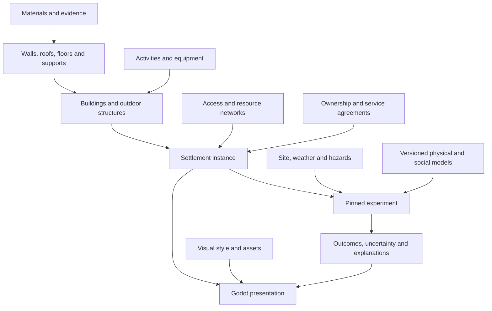
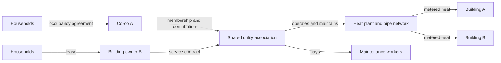
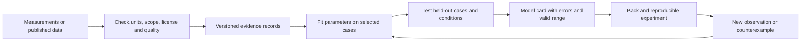
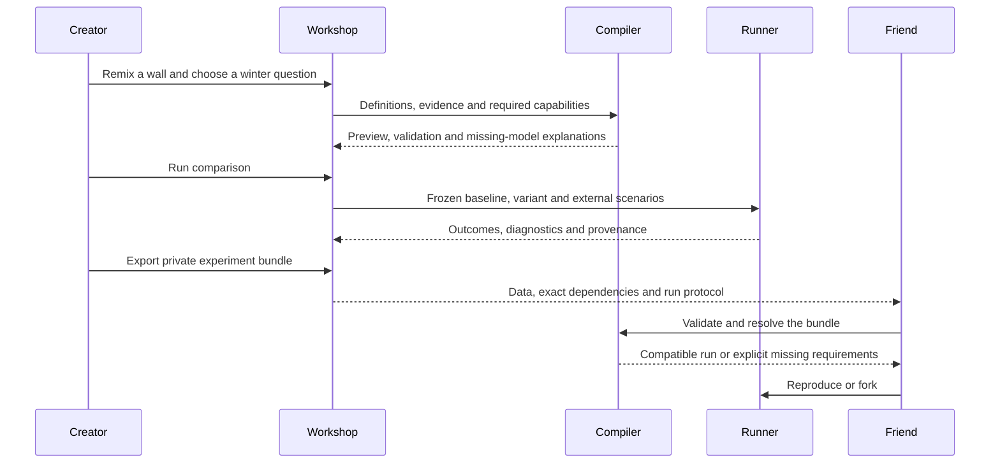

# 🧩 Courtyard Block: moddable community experiments grounded in physics and evidence

**Date:** October 4, 2026.

**Status:** Exploration and recommended direction; the proposed API, physics models, sharing tools and long-term runner are not implemented.

**Repository examined:** `18450d3`, with a clean working tree at the start of research.

**Builds on:** [Composable communities and playful experiments](0000_[_]_COMPOSABLE_COMMUNITY_MECHANICS_AND_PLAYFUL_EXPERIMENTS.md) and the implemented [evening scenario](../evening.md).

## Problem statement

A child should be able to assemble a treehouse community, try a cold winter, notice a problem, change the design and send the experiment to a friend. An experienced modder should be able to add an unfamiliar construction method, a different institution or a better thermal model. A researcher should be able to inspect assumptions, supply measurements and reproduce an experiment without opening the game scene.

The challenge is making those activities work together. A library of attractive buildings is insufficient: construction, utilities, climate, maintenance, ownership and residents must interact. Equally, requiring every player to author a building-energy model and an economic model would make the game inaccessible.

The intended outcome is **a construction toy with an inspectable simulation underneath, and a gradual path from playing to improving the model itself**. “Any community” is a direction for extensibility, not a promise that a finite first release understands every physical or social mechanism.

## Executive summary

**Make reusable capabilities the foundation of modding.** A treehouse, yurt, earth-sheltered house and Berlin courtyard block should be compositions of spaces, assemblies, services, connections and organizations. Their visual style should not select a hidden bundle of happiness bonuses.

Recommend seven commitments:

1. **A common vocabulary:** materials → assemblies → buildings → settlements, connected to resources, activities, institutions and environmental conditions. Introduce new combinations without changing the host for each building type.
2. **A portable authoring path:** remix forms, visual assembly, validated data files and bounded rules. Ordinary mods work on desktop, web and mobile without the Godot editor. Advanced code remains a separate capability tier.
3. **Small physical models with explicit limits:** conserve resources, derive thermal behavior from assemblies, represent finite equipment and maintenance, and distinguish approximate structural/hazard models from detailed engineering analysis.
4. **Evidence attached to parameters and models:** units, sources, geography, dates, uncertainty and applicability travel with the mod. A fictional value stays clearly fictional; a measured input does not make the whole simulation validated.
5. **Experiments as shareable objects:** pin the design, population, models, data, dependencies, seeds and comparison method. A friend opens the same experiment and can fork it.
6. **Multiple time scales:** events for daily life, continuous or interval models for resources and temperature, and explicit long-term models for renewal and population. A hundred-year scenario needs more than a faster clock.
7. **An ecosystem built around useful contributions:** someone can contribute a chair, a wall assembly, a local cost table, a weather file, a co-op rule, a test case or a model correction. Coding a whole mod should not be the entry requirement.

Keep Godot and the scene-independent simulation. First build a **one-year “Warm homes, shared systems” experiment** across deliberately different settlement forms. Use it to extract and verify a narrow API v2. Treat five- and hundred-year runs as later scenario capabilities, gated by validation and measured runtime rather than a promised release date.

## 🔎 Current state in the repository

These are observations from source inspection, not proposed capabilities.

| Area and evidence | What works now | What limits this vision |
| --- | --- | --- |
| [Simulation](../../core/simulation.gd), `create`, `step`, `load_state` | Canonical serializable state; seeded population; scene-independent calculations; separate presentation | Creation clamps population to 150; fixed needs and activity logic; a single `funds` account and global service values |
| [Evening simulation](../../core/evening.gd), `definition_error`, `advance`, `_serve` | Minute-resolved food services, stock, capacity, staff, payments and explanations; deterministic rotating priority | Only `groceries` and `meal`; 16:00–22:00; one chosen local service; fixed household roles; resource totals rather than physical networks |
| [Registry](../../core/catalog.gd), `register_content`, `register_system` | Namespaced definitions, systems, generators, visuals and panels | API v1; registering an unfamiliar content group does not make the planner interpret it; scheduled callbacks must use intervals divisible by 15 |
| [Loader](../../core/mod_loader.gd), `load_roots`, `_register` | Exact dependency versions, stable dependency loading, registration rollback, SHA-256 pack locks | Digest covers manifest and entry script, not all helper files/assets; one installed version per ID; trusted GDScript has application capabilities |
| [Layout validation](../../core/validation.gd), `layout_error`; [routing](../../core/spatial.gd) | Generated spaces and a cached route graph; a separate [garden village](../../mods/garden_village/entry.gd) generator | Requires spaces literally named `courtyard` and `city`; all spaces must be reachable; no independent utility, support or ownership graphs |
| [Base materials](../../content/base/manifest.json); `building_cost` and `_settle_day` | Material choices affect cost, comfort and maintenance | No layer thickness, conductivity, heat capacity, load path, construction quantities, climate or degradation model |
| [Workshop](../../ui/evening_panel.gd), `workshop`; [controller](../../world/main.gd) | Forms, validated service JSON, prototype trials, ZIP export and external AI prompt export | Fixed service form and one prototype ID; no general assembly editor, evidence editor or in-game AI provider |
| [Saves](../../core/saves.gd); `CBSimulation.validate_save` | Atomic file replacement, state forks and original-mode matched-hour comparison; exact pack checking | Installed pack set must match the save exactly; no migrations across model versions; foundation history retains 90 days of hourly samples |
| [Diorama](../../world/diorama.gd) | Batched primitives and separate visual callbacks | No general mesh authoring/import workflow; visual geometry is not a physical building specification |

A subtle extension boundary matters: `CBSimulation.step()` returns immediately through `CBEvening.advance()` in evening mode. The foundation's registered runtime systems are consequently **not a general hook into the evening planner**. The new architecture must unify behavior contracts deliberately instead of assuming the old registry already does so.

The [validation record](../validation.md) reports 608 simulation/extension checks and 14 scene/controller checks for the evening work. The [existing benchmark](../benchmarks/2026-10-02.json) covers the older foundation, 150 residents and synthetic batched geometry on an M1 Max. It is not evidence for annual thermal simulation, large script packs or physical-phone performance. This exploration did not rerun those game suites or benchmark a proposed implementation.

**Keep:** pure calculation boundaries, serializable state, explicit commands, namespaced content, accounted transactions, inspectable events and batched rendering. **Change incrementally:** the hard-coded domain assumptions and the pack/experiment lifecycle.

## 📚 External research

The source observations below are distinct from the design recommendations in the final column. Sources were consulted on October 4, 2026; standards and library versions should be pinned when implementation begins.

| Primary source | Relevant observation | Implication for this project |
| --- | --- | --- |
| [Factorio data lifecycle](https://lua-api.factorio.com/latest/auxiliary/data-lifecycle.html) | Content prototypes and runtime behavior have different lifecycles; dependency order and migrations are explicit. | Compile immutable definitions before a run; separate model updates from live state changes. |
| [Godot runtime loading](https://docs.godotengine.org/en/stable/tutorials/io/runtime_file_loading_and_saving.html) | Runtime JSON/ZIP and glTF loading can support user content without an editor export. | Use our own data package and constrained asset importer for ordinary mods. |
| [Godot resource-pack security](https://docs.godotengine.org/en/stable/tutorials/export/exporting_pcks.html) | Resource packs can contain executable scripts; the documentation explicitly discusses malicious packs. | Loading a PCK is not isolation. Do not use arbitrary scene/script loading as the public data-mod boundary. |
| [JSON Schema composition](https://json-schema.org/understanding-json-schema/reference/composition) | Schemas support reusable definitions and combined validation constraints. | Publish schemas and reuse them for forms, editor hints and validation; add semantic checks for units and physical consistency. |
| [NetLogo BehaviorSpace](https://docs.netlogo.org/7.0.0/behaviorspace) | Users can define repeated experiments, vary inputs, collect metrics and run exported experiments headlessly. | Give players a friendly experiment notebook backed by the same headless runner, with explicit repeats and recorded seeds. |
| [Modelica Buildings reduced-order guide](https://simulationresearch.lbl.gov/modelica/releases/latest/help/Buildings_ThermalZones_ReducedOrder_RC_UsersGuide.html) | Thermal resistance/capacity networks reduce state count and are used where speed or district scale favors simpler models. | Start with a small thermal network and a declared applicability range, rather than rendering-driven physics. |
| [EnergyPlus testing documentation](https://energyplus.readthedocs.io/en/v23.2.0/tips_and_tricks/tips_and_tricks.html#validation-and-testing) | EnergyPlus uses analytical and comparative tests, including building-fabric and BESTEST/ASHRAE 140 cases. | Establish analytical fixtures and independent reference comparisons; matching one tool is only one validation layer. |
| [EnergyPlus EPW dictionary](https://bigladdersoftware.com/epx/docs/24-1/auxiliary-programs/energyplus-weather-file-epw-data-dictionary.html) | Weather files carry location, time conventions, weather fields, missing-value rules and source/uncertainty information. | Import weather through a checked adapter, preserving metadata and radiation/precipitation interval semantics. |
| [Copernicus ERA5](https://cds.climate.copernicus.eu/datasets/reanalysis-era5-single-levels?tab=overview), [projection explanation](https://climate.copernicus.eu/worldwide-regional-climate-projections-now-available-through-c3s) | Reanalysis combines observations and models; future projections depend on scenario assumptions. | Distinguish observations, reanalysis, typical-year files and future scenarios in the UI. Regional data are not measurements of a particular courtyard. |
| [EPA EPANET](https://www.epa.gov/water-research/epanet), [EPA SWMM](https://www.epa.gov/water-research/storm-water-management-model-swmm) | Water-distribution hydraulics and drainage/sewer behavior have specialized models. | Begin with transparent flow/storage networks; use specialist tools as references or optional research bridges when pressure or flood routing matters. |
| [ÖKOBAUDAT](https://www.oekobaudat.de/en), [download archive](https://www.oekobaudat.de/en/service/downloads.html) | Building life-cycle datasets include generic data and environmental product declarations, with versioned downloads. | Import provenance and life-cycle boundaries; an environmental dataset is not automatically a local price, structural rating or complete physical specification. |
| [DOE Building Performance Database](https://www.energy.gov/cmei/buildings/building-performance-database-bpd) | Data from real buildings are cleaned and anonymized for comparisons. | Use compatible empirical observations to challenge model outputs; pooled building data do not establish community-level causation. |
| [Berkeley thermal-comfort field data](https://cbe.berkeley.edu/centerline/new-interactive-thermal-comfort-tools/) | The database pairs occupant responses with measured environmental conditions. | Keep environmental exposure and subjective comfort distinct; validate comfort assumptions against relevant people and conditions. |
| [SimCenter PBE](https://simcenter.designsafe-ci.org/research-tools/pbe-application/), [damage/loss model library](https://simcenter.designsafe-ci.org/products/backend-components/dlml/) | Hazard response, probabilistic damage, loss and recovery can be modeled separately, with documented component models. | Separate hazard, exposure, vulnerability and repair; unsupported building types need new evidence, not a generic “durability” value. |
| [Ostrom's lecture](https://www.nobelprize.org/prizes/economic-sciences/2009/ostrom/lecture/), [lecture text](https://www.nobelprize.org/uploads/2018/06/ostrom_lecture.pdf) | The research treats multiple interacting institutional arrangements rather than a single market/state dichotomy. | Represent organizations and shared agreements explicitly. This is conceptual guidance, not a numerical rule proving any ownership form superior. |
| [ODD model-description protocol](https://www.jasss.org/23/2/7.html) | Model descriptions should explain purpose, entities, scheduling, design and details needed for understanding and replication. | Generate a readable model card alongside every substantial simulation module. |
| [RO-Crate introduction](https://www.researchobject.org/ro-crate/specification/1.1/introduction.html) | A research package can describe files, creators, inputs, workflows and provenance. | Export a lightweight experiment bundle first; provide an RO-Crate adapter for research use later. |
| [Functional Mock-up Interface](https://fmi-standard.org/) | FMI defines an interface and container for exchanging dynamic models, potentially including native binaries and source. | Keep an external-model boundary possible, but do not promise arbitrary FMUs will be safe or portable across game platforms. |

## Key findings

### 1. Make the first mod feel like editing a piece of the game

A proposed first-time journey:

1. Choose **Make a community** → **Treehouses**. A complete small settlement appears, with working starter utilities and visible assumptions.
2. Choose a climate and question: “Can everyone stay comfortable through winter within this budget?” The game chooses a relevant starter report.
3. Select a home → **Make a variation**. Change wall layers, window area or the heat source using pictures and ordinary units. Advanced fields remain expandable.
4. Place the variation; see connections, estimated quantities, access and unresolved model requirements before confirming.
5. Run a season. Inspect a cold evening: the battery depleted, the heat pump could not supply enough heat, and one home cooled faster.
6. Try insulation, shared heat, different controls or storage. Compare cost, comfort, labor and resource use for the same conditions.
7. Choose **Share experiment**. A friend can reproduce the original, inspect assumptions and make a branch.

This is a proposed experience, not a claim that any particular treehouse design is thermally or structurally suitable. Starter pieces need curated assumptions and calibrated models before their results deserve stronger claims.

Expose four levels without separate products:

| Level | What the player edits | What is required |
| --- | --- | --- |
| Remix | Appearance, dimensions, schedules, prices, known materials | In-game form; immediate validation; no coding or account |
| Compose | Assemblies, prefab groups, service chains, connections, shared agreements | Visual editor with typed sockets and reusable templates |
| Experiment | Climate, parameter ranges, population assumptions, outcome measures | Guided notebook; presets for repeats, sensitivity and comparison |
| Extend the model | A genuinely new process, planner or numerical solver | Documented bounded rules where sufficient; reviewed engine module or isolated advanced runtime where necessary |

The UI must explain a missing capability: **“This model represents indoor temperature but does not calculate smoke exposure.”** It must not silently convert a proposed fire pit into a comfort bonus. Fictional assumptions are permitted in creative experiments, with visible labeling.

Give creators a built-in test bench: place one object, supply known inputs, watch outputs, interrupt a connection, and inspect accounting. Reusable tests should ship with the piece. Learning to produce a reliable piece becomes part of skill progression.

### 2. Compose settlements from capabilities, not a building-type switch

Use a small family of definitions and instances:

| Primitive | Examples | Essential contract |
| --- | --- | --- |
| Material | A specific timber product, earth mix, insulation, membrane | Physical properties and evidence under stated conditions; no universal material score |
| Assembly | Layered wall, roof, floor, window, foundation | Geometry, constituent quantities, interfaces, thermal properties and applicable structural model |
| Space | Room, dwelling, outdoor common area, workshop | Boundaries, capacity, access, uses and thermal-zone assignment |
| Equipment/process | Heat pump, stove, tank, pump, composting system | Inputs, outputs, state, throughput, energy, maintenance and failure conditions |
| Activity/service | Cooking, bathing, collecting waste, paid work | People, time, access, staff, stock, costs and completion effects |
| Network/port | Walkway, pipe, cable, heat loop, waste transfer | Resource/type, direction, capacity, quality and explicit boundary providers |
| Organization/agreement | Household, co-op, owner, utility association | Assets, accounts, rights, obligations, decisions and dispute/default rules |
| Site/environment | Climate, soil, slope, vegetation, hazards | Spatial and temporal conditions, input sources and model resolution |
| Scenario/experiment | Winter comparison, five-year maintenance strategy | Initial state, drivers, model versions, intervention, outcomes and run protocol |

Prefabs combine these primitives; settlement templates arrange prefabs. A **Berlin courtyard style** pack can supply geometry, materials and art without dictating ownership. A **resident co-op** pack can apply to several geometries. A **regional price** pack can change procurement without changing a wall's thermal conductivity.



Use **composition over deep inheritance**. Permit explicit variants that patch named fields with expected base hashes; show conflicts rather than letting the last-loaded pack win silently. Compile and record the resulting definition. A cosmetic override must not alter the simulation hash; a mesh that changes authoritative geometry is a design change and must do so.

### 3. Separate the graphs that describe a community

One graph cannot correctly express movement, resource supply, building support and ownership.

| Graph | Relevant edges | Why it matters |
| --- | --- | --- |
| Access | Path, stair, ramp, lift, bridge, transport service | A connected treehouse may still be inaccessible to a resident or waste crew |
| Thermal | Zone-to-zone, zone-to-outside, ground, heat equipment | Two adjoining buildings can exchange heat without sharing a heating bill |
| Resource | Water, electricity, heat, wastewater, waste logistics | Physically adjacent buildings may use separate suppliers or lack an agreement |
| Structural support | Member/connection → supporting member, tree or ground | Upper levels need an explicit support path and applicable capacity model |
| Institutional | Owns, occupies, operates, pays, maintains, grants access | The physical network and the responsibility for it can differ |
| Social | Relationships, groups, opportunities to meet | Proximity creates opportunities; it does not mechanically guarantee friendship |

Replace `courtyard` and `city` as required IDs with discoverable roles, such as common activity space and external provider. Permit multiple or absent common spaces and explicit disconnected components. Unreachable services should produce explainable failures. A disconnected electricity network may be a valid off-grid design; an unsupported bridge is a different problem.

Keep stable IDs independent of array positions. Current `household_` indexing is convenient for a fixed cohort but cannot be the identity contract for merging households, births, migration, shared ownership or demolition. Preserve lineage when entities change.

Test the vocabulary against these examples before calling it general:

| Experiment | Capabilities that must be expressible | What must remain explicit if unsupported |
| --- | --- | --- |
| Treehouse cluster | Elevated paths, support anchors, lightweight assemblies, utility runs, accessibility | Living-tree growth/health, connection fatigue and detailed sway |
| Earthship-inspired homes | Earth coupling, solar exposure, water storage/treatment, off-grid supply, ventilation | Moisture, soil/retaining structure and water quality beyond the selected models |
| Rammed-earth homes | Layered construction, thermal mass, moisture-conditioned material data, labor and curing | Local mix strength and weather durability without applicable evidence |
| Berlin-style courtyard block | Party walls, multiple parcels/buildings, shared access, mixed uses, several owners | Detailed jurisdictional legal rules unless supplied by an explicit ruleset |
| Yurt or hut cluster around a fire | Lightweight envelopes, shared outdoor services, fuel collection, schedules | Indoor/outdoor smoke exposure or fire spread if those models are absent |
| Suburb or cul-de-sac | Longer networks, detached envelopes, roads/paths and outside services | Detailed traffic if the chosen mobility model is only travel-time based |

Describe specific settlement practices and locations when grounding a pack in a real community. Avoid a generic “tribal” behavioral preset or an assumed ladder from traditional to advanced. Materials, technology, family arrangements and governance should be independent choices.

### 4. Physical credibility comes from balances, geometry and declared approximations

Do not use Godot rigid-body physics as the authority for building energy, resource flows or structural suitability. Rendering and collision can help interaction; the simulation needs domain models with units, boundaries and verification.

#### Resources and networks

For a stock over an interval, enforce:

`ending stock = starting stock + imports + production − consumption − exports − losses`

Use typed quantities. **kW is power, kWh is energy; L/min is flow, L is volume.** Energy over an interval is the integral of power. Storage capacity and pipe/pump throughput are separate constraints. Conversions may have efficiencies and waste outputs; losses must have an accounted destination or an explicitly defined boundary.

Reserve scarce stock, money, staff, capacity and outputs before committing a service. Set one responsible model for each state field or conservation balance; two active modules cannot both debit the same consumption. The old per-person daily utility proxy must be replaced, not added to explicit end-use consumption.

Start with capacity-constrained networks plus storage, quality classes and explicit external providers. Potable water, greywater and sewage are different resources; an arbitrary rule cannot declare wastewater drinkable without a named treatment process and assumptions. Gravity, pressure, retention and contamination models become capability modules. Compare representative cases with [EPANET](https://www.epa.gov/water-research/epanet) or [SWMM](https://www.epa.gov/water-research/storm-water-management-model-swmm) when those mechanisms enter scope.

#### Heating, cooling and climate suitability

Derive thermal parameters from envelope area, layer thickness, conductivity, effective heat capacity, openings, ventilation, infiltration, orientation and exposure. Represent party walls and outdoor surfaces differently. Separate thermal mass from insulation. A climate label such as “cold” is useful for selection but insufficient as the input to an annual energy calculation.

A first thermal network can express:

`C × dT/dt = heat from surfaces + ventilation + solar gains + internal gains + heating − cooling`

Here `C` is in J/K and heat terms are in W. A one-node model is a teaching/test fixture; use an air-and-mass model when comparing lightweight and massive assemblies, and validate whether that resolution can distinguish the intended interventions. Earth coupling, moisture and natural ventilation need their own assumptions. The [Modelica reduced-order approach](https://simulationresearch.lbl.gov/modelica/releases/latest/help/Buildings_ThermalZones_ReducedOrder_RC_UsersGuide.html) is a reference for this class of simplification, not a claim our implementation already matches it.

Equipment has finite output, control rules and performance curves with valid ranges. Supplied electricity constrains delivered heat. Cooling rejects heat; fuel use creates exhaust/waste streams where represented. Report unmet demand and indoor conditions, not only billed energy. Cost savings caused by residents being cold must be visible as a tradeoff.

Report hours outside a selected comfort band, temperature extremes, humidity where modeled, energy, peak demand, and who bears discomfort. Label the initial band as a scenario choice. Richer comfort models require occupancy, clothing/activity and appropriate evidence; [field comfort data](https://cbe.berkeley.edu/centerline/new-interactive-thermal-comfort-tools/) are relevant, while temperature alone does not establish general well-being.

#### Structural integrity and disasters

Use a progression of declared capabilities:

1. **Geometric/support checks:** attachments, support paths, spans and assigned capacities under stated load cases. These catch obvious unsupported designs but are not structural certification.
2. **Assembly behavior:** member and connection models, material condition, moisture, degradation and repair. A material's nominal strength alone does not establish a building's capacity.
3. **Hazard response:** scenario-specific wind, flood, snow, heat, drought, fire or seismic intensity → exposure → demand/damage → service interruption → recovery.
4. **Optional specialist comparison:** selected structural analysis and fragility models through an offline bridge, with documented applicability.

Do not give every building one “disaster resistance” number. Flood depth, wind load and earthquake demand are different quantities. A fragility curve for a documented building class must not silently cover treehouses or unfamiliar earth construction. [SimCenter's separation of response, damage and loss](https://simcenter.designsafe-ci.org/research-tools/pbe-application/) provides a useful pattern.

Model coupled consequences: a storm can interrupt power, which stops a pump, which affects sanitation and work. Preserve shared causes and correlated events; independently rolling each subsystem can erase these relationships. Show recovery labor, spare parts, service downtime and displacement as well as repair spending.

Start the playable annual experiment with **weather and heat/cold stress**. Add other hazards one at a time with evidence-backed fixtures. The label “not represented” is preferable to a confident invented damage probability.

#### Construction, maintenance and costs

Replace the single cost multiplier with a bill of quantities generated from geometry and assemblies: material quantities, waste allowance, transport, equipment, labor hours/skills, assembly time and replacements. Add land, design, finance and permits as separate scenario costs when modeled. Existing buildings need acquisition and retrofit modes so every experiment is not charged for a new build.

Prices need a region, currency, date, quantity basis and inclusion boundary. Track whether taxes, transport and labor are included. Keep nominal and inflation-adjusted results distinct; expose financing assumptions rather than treating construction price as affordability. These are simulation design requirements, not current market estimates.

Embodied environmental impacts can use compatible [ÖKOBAUDAT datasets](https://www.oekobaudat.de/en), but preserve declared units and life-cycle modules. Do not merge cradle-to-gate and whole-life values into one ranking. Never infer procurement price or strength merely from an environmental declaration.

Maintenance should consume actual time, stock and funds. Degradation can reduce performance and trigger repair decisions; a hundred-year model must include component replacement, not just multiply the first year's operating cost.

### 5. Organizations belong in the simulation as first-class entities

Separate **ownership, occupancy, operation, payment and maintenance**. A household can occupy a home it does not own, belong to a co-op and purchase heat from a jointly owned plant. One organization can own several buildings; several organizations can share one system.



An agreement should declare participants, assets/services, access rights, allocation, fees, reserve contributions, maintenance responsibility, decisions, notice periods and defaults. Decision rules can start as named policies—one member/one vote, ownership share, delegated operator—whose costs and delays are explicit. Do not pretend to reproduce a jurisdiction's law without a suitable ruleset.

Use double-entry transfers between named accounts, with explicit outside counterparties, debts and reserves. Membership and physical connections are different: a pipe can exist while a service agreement is absent. Rules may define what happens then, including continued basic service; the host should not assume disconnection is always the answer.

A useful experiment is: **three adjacent buildings share a boiler; who finances replacement, who authorizes it, and what happens when one member cannot contribute?** Compare equal fees, usage fees and income-linked contributions. Account for paid and unpaid labor, delays, comfort and household liquidity. Do not bake “co-op increases happiness” or “private ownership increases efficiency” into the kernel.

This design is informed by [Ostrom's account of varied, interacting institutions](https://www.nobelprize.org/uploads/2018/06/ostrom_lecture.pdf). Numerical behavioral responses still require separate hypotheses and evidence.

### 6. Real-world grounding needs an evidence workflow

Every important input should support an evidence record:

- Value or distribution, unit and the physical/statistical quantity being described.
- Source URL/DOI or local document reference, publisher, license, access date and content hash where available.
- Observation period, location, measurement method, sample size and relevant building/community characteristics.
- Conditions and applicability: moisture, temperature, assembly, occupation, climate, technology or institutional setting.
- Transformations, conversions, fitted parameters, missing-data treatment and uncertainty assumptions.
- Status: **measured, derived, estimated, synthetic or unknown**. Use separate fields for validation and applicability, not one truth score.

Evidence should be inspectable by clicking an ordinary value: “Why does this wall cost this much?” A novice can keep a curated default; an expert can replace the evidence and rerun. Missing evidence should permit a labeled speculative experiment, while excluding it from claims of validation.



#### A practical data acquisition path

| Need | Starting source or method | Important boundary |
| --- | --- | --- |
| Historical weather | Local station observations, checked EPW files, or [ERA5](https://cds.climate.copernicus.eu/datasets/reanalysis-era5-single-levels?tab=overview) | Record whether observations or reanalysis; site exposure, resolution and interpolation matter |
| Future weather | Explicit projection pathways and documented downscaling/weather generation | A chosen pathway is not a forecast of weather in a particular future year |
| Material/assembly properties | Product tests, technical declarations and applicable research; separate environmental data | Different mixes, moisture and construction details can invalidate substitutions |
| Actual energy use | Consented utility records and matched building descriptions; [BPD](https://www.energy.gov/cmei/buildings/building-performance-database-bpd) for suitable comparisons | Aggregates, occupancy and meter boundaries must match what the model predicts |
| Construction/maintenance | Dated local quotes, bills of quantities, repair logs and labor records | No single worldwide cost table; record donated labor and excluded costs |
| Water/waste | Meters, service contracts, collection records and process specifications | Shared/off-site services must remain within the declared accounting boundary |
| Daily life and institutions | Voluntary time-use diaries, accessible service maps, organization records and surveys | Use synthetic or aggregate households for sharing; avoid exporting identifiable personal routines |
| Thermal comfort | Relevant field studies and optional consented observations | Subjective experience is not identical to an indoor temperature reading |

Start with a small number of well-described reference communities, ideally including one cooperative block and one detached/clustered settlement. Do not invent calibration datasets to populate the catalog. A data contribution form should allow community members to explain the context and uncertainty of their records, not merely upload a number.

Use calibration and validation separately. Fit on one set of periods/buildings; evaluate on held-out periods and different conditions. Record bias and error for each outcome: annual energy, cold hours, peak load, water demand, maintenance spending and travel time need different checks. A matching annual total can conceal wrong winter peaks. A fitted social outcome does not prove the modeled causal mechanism.

Maintain a readable model card based on the [ODD protocol](https://www.jasss.org/23/2/7.html): question, entities, scheduling, mechanisms, initialization, input data, parameters, validation, uncertainty and omissions. Make it generated from structured metadata where possible, supplemented by author explanation.

### 7. A year, five years and a century are different products of the model

A shorter timestep alone does not create realism, and a larger timestep is not a valid shortcut through changes that matter.

| Horizon | Questions it can eventually address | Additional requirements |
| --- | --- | --- |
| Evening/day | Can people reach services and find time for one another? | Activities, access, queues, household stock and transactions |
| Season/year | Can this design meet needs across weather and seasonal demand? | Weather chronology, thermal/storage state, supplies, maintenance and annual budgets |
| Five years | Is the arrangement affordable and maintainable under selected changes? | Replacements, finance, household changes, repair capacity, external prices/jobs and policy scenarios |
| Hundred years | Which strategies remain viable across many possible futures? | Demography, migration, redevelopment, land/ecology constraints, climate pathways, technology assumptions, institutions and explicit structural uncertainty |

Offer a choice of question and model scope. A **fixed-population building lifecycle** run can address maintenance over a century without claiming to simulate social evolution. A **community evolution** run requires aging, births, deaths, household formation, care, migration and housing/work capacity. Do not extrapolate today's 24 adults and fixed wages as if that were population dynamics.

Treat family aspirations and choices as explicit, variable behavioral assumptions; avoid one compulsory family pattern or equating more births with better well-being. Distinguish original residents, current residents, newcomers and people who left. An improving average must not hide displacement or attrition.

Future external conditions—climate, energy prices, regional employment, policy, migration and technology—belong in versioned scenario drivers. Some can be endogenous in a richer model, but the boundary must be clear. A small settlement need not simulate the entire world economy.

#### A practical time architecture

- **Discrete events:** activity completion, equipment switching, deliveries, contracts and failures; ordered deterministically by time, phase, policy priority and stable event ID.
- **Physical intervals:** temperature, storage and network flow integrate up to the next relevant event, with bounded substeps or analytic updates where valid.
- **Slow processes:** accounting, maintenance inspections, demographic transitions and scenario updates run at declared intervals or event times.
- **Rendering:** interpolates selected states independently; turning off animation must not change outcomes.

Coupled solvers need an explicit contract. For example, the thermal module requests heat; the dispatch module allocates constrained energy; temperature advances from delivered heat. Either solve the coupling with bounded convergence checks or document a staggered method and demonstrate timestep convergence. Never run two modules in arbitrary callback order and call the result physical coupling.

At 15-minute resolution, 100 non-leap years contain **3,504,000 intervals**. Scanning 150 people each time is **525,600,000 person updates**, before networks or repeated trials. One-minute scanning would require **7,884,000,000 person updates**. These are arithmetic workload counts, not measured runtime estimates.

Use scheduled events, cached routes, precompiled definitions, sparse networks and compact numeric state. Replace per-callback full-world deep copies with restricted read views and validated proposals. Keep an accessible reference implementation; move only measured hot solvers into Rust or another native module when worthwhile. [Godot's extension configuration](https://docs.godotengine.org/en/stable/engine_details/engine_api/gdextension/gdextension_file.html) and [web export settings](https://docs.godotengine.org/en/stable/classes/class_editorexportplatformweb.html) make platform-specific builds and capability checks necessary; Rust does not automatically give third-party mods identical deployment everywhere.

For long runs, a declared aggregate model may summarize routine activity, retaining inventories, cohorts, capital stock and critical events. Validate it against detailed runs in overlapping cases. Representative-day approaches need special care with seasonal storage, multi-day cold spells, outages and path-dependent choices. Never let camera distance silently change authoritative model fidelity.

Retain monthly/annual aggregates plus selected episodes, versioned checkpoints and lineage. Do not retain every resident-minute for a century. A compressed year can offer a monthly summary and replay a retained difficult week; it cannot truthfully invent missing detailed histories afterward. All long jobs need progress, cancellation and resume, including browser suspension.

#### Compare futures fairly

Pin separate random streams for weather, hazards, population and policy behavior, keyed by stable identities/events where appropriate. Merely starting from the same global seed does not preserve common external events when one design consumes extra random numbers. Match exogenous scenarios across alternatives; allow outcomes and decisions to diverge.

Support multiple seeds, parameter sweeps, sensitivity tests and alternative model structures. Preserve correlations among uncertain inputs; do not independently sample physically incompatible material properties. Choose repeat counts based on stability of reported summaries, not a magic universal number. Distinguish stochastic variation, uncertain parameters and disagreement between models.

An output should say “Under these assumptions, these runs had fewer cold hours and higher construction cost,” and expose distributions, failed runs and denominators. Avoid turning a century of uncertain social evolution into a single confidence percentage or an exact prediction.

### 8. Use a layered mod contract

| Tier | Allowed capability | Portability and boundary |
| --- | --- | --- |
| Portable data | Definitions, prefabs, datasets, schedules, tables, scenarios and approved assets | Default sharing path; no arbitrary code or resource loading; validate sizes, references and domains |
| Bounded rules | Finite state machines, typed expressions, event subscriptions, queries and proposals | Implement an interpreter with instruction, memory, event and collection limits; no recursion, unbounded loops, filesystem or network |
| Advanced model module | New planner or solver needing algorithms outside the rule vocabulary | Initially maintained as reviewed host modules; later evaluate an isolated runtime. Existing trusted GDScript is a separate advanced path |
| Research bridge | EnergyPlus, Modelica, EPANET, SWMM or structural tools | Export/import or optional desktop/service execution; separately versioned and tested; never a hidden requirement for ordinary play |

**Do not promise that every new scientific mechanism fits a no-code editor.** The editor makes existing capabilities easy to combine. New mechanics can require a new module, which becomes a reusable capability for everyone once supported. This is the practical route to an expanding vocabulary.

Bounded rules should expose operations such as request stock, reserve a service, transfer money, schedule a task and change declared private state. The host validates proposed effects and applies them atomically. Continuous conservation equations and numerical solvers belong in model modules, not arbitrary stat-changing callbacks. Rule evaluation errors must identify the pack, input and rejected proposal.

Keep the runtime interface small: model version, required inputs, owned outputs, units, scheduling, initial state, state schema, domain limits, errors and test fixtures. Third-party models implementing the same interface can be compared, but two replacements cannot simultaneously own the same outputs. Model selection is pinned in the experiment.

Schema validation is only the first pass. Compile semantic checks for missing definitions, unit mismatches, invalid areas/volumes, disconnected required ports, duplicate ownership, impossible outputs, unsupported model domains and unbounded work. Generate form controls and reference documentation from the same schema and annotations. JSON remains a portable interchange format; the runtime may compile it into typed arrays and indexes.

### 9. Package the experiment, not just the building

Proposed package roles:

- **`.cbmod.zip`:** reusable definitions, assets, evidence and tests.
- **`.cbexperiment.zip`:** question, scenario, initial state, changes, exact dependency lock, data/model hashes, seeds, run settings and optional results/checkpoints.
- **Research export:** CSV/JSON outputs plus human-readable model cards and, later, [RO-Crate metadata](https://www.researchobject.org/ro-crate/specification/1.1/introduction.html).

Use semantic versions for authors and **content hashes of every included file** for identity. A deterministic file index should normalize paths and hash file bytes in canonical order, excluding its own digest/signature fields. Include helper scripts, textures, models, datasets and migration code. A signature authenticates a publisher and bytes; it does not establish safety or scientific truth.

Pin host build, simulation ABI, model versions, compiler/numeric policy, resolved definitions and data. Avoid live network fetches during a deterministic run. Distinguish exact replay on the same numerical implementation from cross-platform agreement within declared tolerances; float behavior and solver decisions require explicit conformance tests before claiming bitwise identity everywhere.

Resolve dependencies **per experiment**, allowing several versions in a content-addressed local cache. Support manual file exchange first; a hosted registry should later be an optional discovery and synchronization service. Friends can share privately without publishing to a marketplace. Offline bundles should contain redistributable dependencies; restricted datasets must be identified with clear acquisition requirements rather than silently omitted.



A scientific result also needs the failed/aborted trials and the run-selection rule. A gallery screenshot may be illustrative, but a claimed comparison should link to its experiment record. Separate a **design intervention** from a **model correction**: changing insulation and changing the insulation equation answer different questions.

### 10. Safe sharing and compatibility are part of ease of use

The current loader's archive checks do not turn GDScript into a sandbox. Keep trusted scripts visibly separate from data packs. The public portable importer should read allowed formats without executing scene resources, shaders or embedded scripts. Use approved material/visual recipes and constrain mesh/texture sizes, decoded memory, external URIs, nested archives and parser depth.

Validate and unpack into staging; activate only after full success. Set limits before expensive allocation/decompression where the library permits, and reject unsupported cases. Inspect duplicate/case-colliding paths, path traversal, symlinks and surprising encodings. File-size limits alone are not work or memory budgets. A data rule can also exhaust the host unless events, queries and state growth are metered.

Do not unload a missing physics mod and continue with altered outcomes. Offer the matching pack, a read-only result view or an explicit migration. Migrations should run on a copy, record provenance and validate balances and references before committing. Reference modules can remain available for reproducing old experiments; critical security constraints may instead require an archived report or controlled offline workflow.

Permission prompts should be rare and meaningful. Opening a validated data experiment should be ordinary play. Enabling arbitrary trusted code, sending selected data to an external service or publishing publicly are different actions with visible scope. A future gallery needs licensing, attribution, reporting, moderation and private defaults suitable for young creators; this is not required to begin local file sharing.

### 11. AI should help author the same artifacts as the visual tools

AI is optional and outside simulation ticks. It should produce a patch to ordinary definitions, an explanation of assumptions, required capabilities and suggested tests. Forms, text files and AI output go through the same compiler and isolated trial workflow.

Examples of useful requests:

- “Make a version of this home with a shared heat loop and explain the new maintenance tasks.”
- “Import this material test table, retain its units, and show which properties are missing.”
- “Why does this community run out of water during this week?”
- “Create a test that checks whether the new tank conserves water.”

The assistant should not invent a source, quietly substitute a different material, or claim that an absent smoke model is present. Suggested values remain synthetic or estimated until evidence is supplied. Passing an AI-generated test is not empirical validation; use independent tests and reference cases.

Initially extend today's prompt/export/import workflow with generated schemas and diagnostics. An integrated provider can follow when selected-data consent, cost visibility, rollback and artifact validation exist. No account or provider should be required to build, run, inspect or exchange an ordinary experiment.

### 12. An ecosystem needs stable contracts and small contributions

Ship the base game through the same public contracts. Publish the format specification, reference packs, conformance tests, compatibility policy and headless runner interface. Choose explicit licenses for schemas, SDK examples, assets and datasets rather than assuming one repository license covers every contribution.

Seed the ecosystem with complete, remixable examples and small challenge templates: winter warmth, a shared water reserve, three owners funding maintenance, a kitchen with unpaid labor, and a long accessible route. Include positive goals and quiet creation time as well as failures. Progress can reward explaining a result, making a reusable piece and reproducing a friend's experiment.

Discovery should separate **works on my platform**, **schema/tests passed**, **has documented sources**, and **validated for these conditions**. Popularity is not evidence quality. Let someone publish an attractive fictional settlement without presenting it as an engineering result.

Support translation, local units in the interface, accessible forms, touch-sized controls and template-based creation. Treat the core unit system as canonical, converting only at import/display boundaries. Modders should not need to supply every UI layout; schema annotations should produce reasonable inspectors with optional expert customization.

## Options and tradeoffs

| Option | Strengths | Costs and limits | Decision |
| --- | --- | --- | --- |
| Continue adding v1 definitions and callbacks | Fast for more evening services and cosmetic variety | Hard-coded planner, budgets and geometry remain; trusted code and global pack state limit easy sharing | Preserve for compatibility; insufficient as the long-term contract |
| Expose arbitrary Godot scripts/scenes as the main mod API | Maximum short-term access for experienced developers | High coupling to implementation, unsafe unknown code, expensive support and platform differences | Keep an explicit advanced path, not the default |
| Build a fully general simulation language first | Broad theoretical expressiveness | Modders still need modeling expertise; difficult tooling, validation and performance; little playable guidance | Avoid as the first delivery |
| Embed detailed engineering tools into every run | Rich mechanisms for supported domains | Setup burden, runtime cost, binary/platform constraints and difficult cross-domain coupling | Use reference tests and optional bridges |
| Data composition + bounded rules + versioned model modules | Easy entry, inspectable assumptions, useful extension boundary, controlled cost | Requires carefully designed contracts, examples, validation and ongoing module development | **Recommended** |

FMI is worth retaining as a possible external boundary, not an early dependency. Its [model-exchange container/interface](https://fmi-standard.org/) does not remove executable-code, solver-coupling or platform concerns. Likewise, a future WebAssembly runtime would need metering, restricted imports and compatibility work; the word “WASM” alone is not a finished sandbox.

## 🛠 Recommendation and migration strategy

Build **a community experiment platform through playable slices**, starting with thermal/resource composition and shared maintenance. Keep the current evening playable while extracting contracts; do not rewrite the entire game or silently upgrade its assumptions.

### First proving ground: “Warm homes, shared systems”

Use 24–48 synthetic residents and three contrasting layouts: courtyard block, detached cluster and elevated cabins. Offer two curated climates, layered envelopes, constrained heat/electricity/water, waste collection, and two or three organizations with explicit maintenance agreements. Include a cold spell and an equipment outage. All of these are proposed scope; calibrated inputs still need to be acquired.

The key questions are small enough to understand: “Who is cold?”, “Why is the shared account empty?”, “Does insulation or a different heat system help more?”, and “Who does the repair work?” Offer season previews before a full year. A creator should be able to add a fourth dwelling prefab or a different fee policy without editing the host.

Structural capability in this slice should be declared support/connection checks with documented limits. Do not market elevated cabins as a verified living-tree model. Earth-coupled construction, moisture and other hazards follow when their required modules can be tested; the API should already let their packs declare those requirements.

### Proposed code boundaries

The paths below are **new responsibilities to introduce**, not existing files.

| Proposed boundary | Responsibility | Existing seam |
| --- | --- | --- |
| `core/definitions/` | Schemas, evidence, namespaces, quantities, semantic compilation and immutable indexes | `catalog.gd` and `mod_loader.gd` |
| `core/experiments/` | Per-run dependency locks, scenario drivers, variants, checkpoints and result provenance | `saves.gd`, evening reports and controller comparisons |
| `core/runtime/` | Stable entity IDs, event scheduler, read views, proposals, reservations and atomic reducer | `simulation.gd`, `evening.gd` |
| `core/models/` | Explicitly versioned thermal, flow, activity, institutional and later hazard modules | Extract from host-specific logic; do not expose scene nodes |
| `content/reference/` | First-party materials, assemblies, prefabs, policies, evidence and benchmark fixtures | Existing base and example packs |
| `ui/workshop/` | Schema-driven forms, assembly editor, test bench and diagnostic explanations | `evening_panel.gd` |
| `tools/` | Pack compiler/validator, headless experiments, migration checks and research adapters | `scripts/package_mod.py`, `scripts/check.py` |

Keep the simulation calculation declarative: **read state → propose changes → resolve constraints → commit → record evidence**. Internally compiled numeric structures are compatible with a serializable public state; derived caches should be rebuildable after load.

### Implementation checklist

An initial annual slice was implemented on October 4, 2026; see the [implemented features, API, limits and verified checklist](../lab.md). The broader contract/generalization items below remain open unless fully satisfied. In particular, the current annual model is separate from the evening activity engine, its inputs are illustrative, and it has no general port editor or multi-year demography.

**Stage 1 — Define and prove the contracts**

- [ ] Specify API v2 quantities, stable IDs, components, ports, model ownership, errors and evidence records; generate forms/docs from schemas.
- [ ] Define exact model/engine/data identity and a complete file-hash lock independent of global installation state.
- [ ] Add per-experiment loading, staging, bounded data import and side-by-side pack versions.
- [x] Keep v1 saves on the v1 model path; retain them separately with explicit mode selection and reject incompatible imports. No automatic conversion is performed.
- [ ] Port a base service, one assembly and a fee rule through public contracts; verify an independent pack can compose them.

**Stage 2 — Generalize the world and accounting**

- [ ] Replace mandatory `courtyard`/`city` identities with roles and external-provider contracts.
- [ ] Separate access, thermal, resource, support and institutional graphs; add prefab ports and assembly surfaces.
- [ ] Introduce organizations, accounts, occupancy, service agreements and recorded paid/unpaid labor.
- [ ] Define resource balances, allocation policies and model coupling; prevent duplicate accounting with legacy proxies.
- [ ] Extract activity/reservation logic so services can run outside the six-hour scenario without a second special-case engine.

**Stage 3 — Make the annual slice useful**

- [ ] Acquire and document reference inputs; ship curated weather/material/price assumptions with explicit evidence status.
- [ ] Implement and validate a minimal thermal model, constrained equipment, flow/storage networks and maintenance events.
- [ ] Build the three settlement fixtures and shared-service agreements; expose one independent prefab and policy extension.
- [ ] Add season/year runs, matched external scenarios, per-resident outcomes and a readable evidence inspector.
- [ ] Create a simple visual assembly/remix editor, connection preview, undo and sandboxed data trial.

**Stage 4 — Make contributions portable**

- [ ] Export/import full private experiment bundles; identify non-redistributable dependencies and platform requirements.
- [ ] Add headless repeated experiments, sensitivity studies, checkpoints, diagnostics and bounded result storage.
- [ ] Publish schema/SDK licenses, examples, tests and compatibility guarantees; add optional discovery only after file exchange works.
- [ ] Extend AI prompt/import with schema-specific patches and diagnostics; later integrate optional providers through the same path.
- [ ] Add validated asset ingestion and clear data-versus-trusted-code capability displays.

**Stage 5 — Expand realism and horizon selectively**

- [ ] Add earth/soil coupling, moisture, structural assemblies and hazard modules against relevant fixtures and evidence.
- [ ] Add five-year renewal/finance scenarios with explicit external assumptions and held-out validation where available.
- [ ] Add demographic/household and redevelopment modules before claiming community evolution.
- [ ] Validate aggregate long-run models against detailed intervals; expose century scenarios with uncertainty and omitted mechanisms.
- [ ] Profile target hardware; optimize measured hot kernels and independently verify each supported platform.

Each stage should end with a playable contribution from someone who did not write the host. Progress is proven by what a creator can express and explain, not by the number of registered content IDs.

## ✅ Validation checklist

### Ease of creation and play

- [ ] A novice completes remix → place → run → inspect → share without code or a verbal walkthrough; initial product target: first useful remix within ten minutes, to be tested rather than claimed.
- [ ] A friend imports and reruns privately without the Godot editor or manual dependency repair.
- [ ] Pointer, keyboard and touch all support assembly, connecting ports, reading evidence and comparing outcomes; no hover-only essential action.
- [ ] Players distinguish a failed design, a bad input, an unsupported mechanism and a model defect.
- [ ] At least two interventions are attractive in different circumstances; observe voluntary iteration and creative play rather than only task completion.

### Composability and compatibility

- [ ] Run one service and one institution pack across a courtyard, detached cluster and elevated settlement without host type switches.
- [ ] Add a new material, assembly, prefab, dataset and policy independently; reject a new mechanism when no capable module exists.
- [ ] A visual-only change leaves numerical outcomes unchanged; authoritative geometry changes invalidate affected calculations.
- [ ] Detect definition conflicts, missing capabilities, cycles, unsupported units and duplicate model ownership with useful messages.
- [ ] Reproduce old experiments with exact dependencies; migration preserves references and balances or rejects atomically.
- [ ] Mod trials cannot overwrite source experiments; aborts, failed imports and interrupted installations leave usable prior state.

### Physics, accounting and evidence

- [ ] Verify stock, mass/energy and financial balances with explicit boundaries; test capacity, losses, efficiency and state limits.
- [ ] Check analytical thermal cases, zero-load equilibrium, timestep convergence, equipment saturation and shared-wall exchange.
- [ ] Compare defined thermal cases with an independent reference tool; compare compatible held-out observations separately.
- [ ] Include adverse conditions: extended cold/heat, depleted storage, power outage, blocked wastewater, absent staff and delayed repair.
- [ ] Check support/load applicability and hazard units; refuse unsupported structural/fragility classifications.
- [ ] Verify bill-of-quantities units, region/date/currency, duplicate charges and maintenance/replacement boundaries.
- [ ] Confirm every published “measured” value has supporting evidence, and every validation badge specifies outcome, scope and error.
- [ ] Preserve data licenses, source transformations, missing-data flags and privacy boundaries in exports.

### Experiments and long runs

- [ ] Save/resume reproduces a continuous run on the declared reference implementation; check cross-platform tolerances separately.
- [ ] Matched alternatives retain the same external weather/hazard streams despite divergent actions and event counts.
- [ ] Record failed runs, uncertain inputs, correlations, model alternatives and the comparison protocol.
- [ ] Verify original-cohort, current-population and mover outcomes separately; report denominators and attrition.
- [ ] Validate aggregate/detailed overlap and path-dependent storage; never infer a detailed history that was not simulated or retained.
- [ ] Century runs include explicit demographic/economic/climate assumptions or are clearly labeled fixed-population asset scenarios.
- [ ] Runtime and memory remain bounded across checkpoints and long horizons; cancellation/resume works after browser/mobile suspension.

### Security and performance

- [ ] Fuzz archives, schemas, expression depth, decoded assets, references and event cascades before accepting public packs.
- [ ] Verify data mode cannot load scripts, native binaries, arbitrary shaders or network resources; test all asset import paths.
- [ ] Measure compile time, first placement, rebuild, solver work, repeated-run throughput and peak memory, not only frame rate.
- [ ] Establish budgets on a named low-end desktop and physical mobile devices; record browser/native differences and thermal behavior.
- [x] Re-run `godot --headless --path . --script tests/run.gd` after simulation/API work, plus evening and annual lab scene checks.

## Example code and data

**The following are proposed API v2 illustrations, not loadable v1 mods.** Values are synthetic teaching inputs. The document does not add a production schema or calibrated material pack.

### Evidence-bearing material definition

This shows the authoring format. The compiler would resolve units and references once, then use compact numeric data at runtime. A real material needs additional properties and applicability checks for each model that uses it.

```json
{
  "schema_version": 2,
  "id": "demo:panel_material",
  "kind": "material",
  "name": "Demonstration panel material",
  "properties": {
    "density": {
      "value": 500,
      "unit": "kg/m3",
      "evidence": "demo:teaching_assumption"
    },
    "thermal_conductivity": {
      "value": 0.13,
      "unit": "W/(m*K)",
      "evidence": "demo:teaching_assumption"
    },
    "specific_heat_capacity": {
      "value": 1600,
      "unit": "J/(kg*K)",
      "evidence": "demo:teaching_assumption"
    }
  },
  "evidence_records": [
    {
      "id": "demo:teaching_assumption",
      "status": "synthetic",
      "source": null,
      "uncertainty": {"kind": "unspecified"},
      "applicability": "Thermal teaching fixture only; no structural rating",
      "note": "Illustrative values chosen for this example, not measurements."
    }
  ]
}
```

Unknown uncertainty is not zero uncertainty. A real sourced record would add provenance, conditions and an uncertainty description justified by evidence; the editor must not fabricate a statistical distribution.

### Bounded policy rather than arbitrary state mutation

An agreement can select a supported allocation rule. The host checks membership, quantities, authorization and accounting; a rule cannot simply overwrite an account balance.

```json
{
  "schema_version": 2,
  "id": "demo:shared_heat_agreement",
  "kind": "agreement_template",
  "requires": {"core:metered_service_agreements": "1.0.0"},
  "service": "core:delivered_heat",
  "billing": {
    "interval": "calendar_month",
    "usage_cost": {"allocation": "metered_use"},
    "fixed_cost": {"allocation": "equal_active_members"},
    "reserve_contribution": {
      "allocation": "equal_active_members",
      "amount_per_member": {"value": 1200, "unit": "EUR_cent"}
    }
  },
  "maintenance": {
    "responsible_party": "operator",
    "approval": "majority_of_active_members"
  },
  "unpaid_invoice": {"action": "record_arrears_and_notify"}
}
```

All referenced capabilities and allocation policies must be declared by the selected model pack. For zero members, invalid meter readings or an undefined operator, reject the configuration or emit a defined failure; never divide by zero or silently invent a payer. Allocation must specify rounding of integer cents, membership timing, dispute handling and who actually receives funds. Those details belong in the reusable agreement module.

### A pure thermal fixture with explicit units and assumptions

This typed GDScript function returns the exact one-node temperature under **constant** conductance, outdoor temperature and net heat input during an interval. It is a small analytical fixture, not a complete dwelling model. It has no scene, clock, randomness or filesystem access.

```gdscript
static func temperature_after(
    inside_c: float,
    outside_c: float,
    capacity_j_per_k: float,
    conductance_w_per_k: float,
    net_gain_w: float,
    elapsed_s: float
) -> float:
    assert(capacity_j_per_k > 0.0)
    assert(conductance_w_per_k >= 0.0 and elapsed_s >= 0.0)
    if conductance_w_per_k == 0.0:
        return inside_c + net_gain_w * elapsed_s / capacity_j_per_k
    var equilibrium_c := outside_c + net_gain_w / conductance_w_per_k
    var decay := exp(-conductance_w_per_k * elapsed_s / capacity_j_per_k)
    return equilibrium_c + (inside_c - equilibrium_c) * decay
```

With 20 °C inside, 0 °C outside, `C = 1,000,000 J/K`, `H = 100 W/K`, no gains and one hour, the result is approximately **13.9535 °C**. With 2,000 W of constant net heat input under those same conditions, temperature remains 20 °C. When `H = 0`, the function follows `ΔT = Q × Δt / C`.

The caller must validate finite inputs and model applicability before this calculation; assertions alone are not a production data-validation boundary. Controllers, solar changes and resource constraints create interval boundaries. A complete coupled update also accounts for supplied energy and heat leaving the zone. This fixture illustrates testable functional calculations; it does not validate the full thermal model.

### Example experiment layout

```text
winter-community.cbexperiment.zip
├── experiment.json          # question, outcomes, comparison and horizon
├── model-lock.json          # host/model versions, resolved packs and hashes
├── initial-state.json       # stable identities and initial inventories
├── variants/                # baseline and explicit design patches
├── drivers/                 # weather, external prices and hazard scenarios
├── evidence/                # sources, applicability and transformations
├── dependencies/            # redistributable exact pack files
├── checks/                  # invariant and expected-behavior fixtures
├── results/                 # summaries, failures, diagnostics and run metadata
└── README.md                # human-readable question, assumptions and limits
```

The pack compiler creates the lock and validates the bundle; authors should not have to hand-maintain hashes. The exported experiment remains runnable without optional results, provided all required inputs and compatible runtime capabilities are available.

## References and research record

Primary sources are linked beside their observations and recommendations above. Particularly useful implementation starting points are the [Factorio lifecycle](https://lua-api.factorio.com/latest/auxiliary/data-lifecycle.html), [Modelica thermal-model guide](https://simulationresearch.lbl.gov/modelica/releases/latest/help/Buildings_ThermalZones_ReducedOrder_RC_UsersGuide.html), [NetLogo experiment guide](https://docs.netlogo.org/7.0.0/behaviorspace), [ODD protocol](https://www.jasss.org/23/2/7.html) and [Godot runtime-content documentation](https://docs.godotengine.org/en/stable/tutorials/io/runtime_file_loading_and_saving.html). Their design lessons are not claims of implementation or external endorsement.

Repository evidence: [current game overview](../../README.md), [v1 mod contract](../modding.md), [evening model and workshop](../evening.md), [foundation assumptions](../model.md), [recorded validation](../validation.md), [catalog](../../core/catalog.gd), [loader](../../core/mod_loader.gd), [simulation](../../core/simulation.gd), [evening engine](../../core/evening.gd), [layout/save validation](../../core/validation.gd), [spatial graph](../../core/spatial.gd), [saves](../../core/saves.gd), [workshop](../../ui/evening_panel.gd), [diorama](../../world/diorama.gd), and [packaging tool](../../scripts/package_mod.py).

Document checks: both JSON illustrations parse; local references resolve; fenced blocks are balanced; the extracted GDScript thermal fixture passes four checks in Godot 4.7.2 (cooling, equilibrium, zero conductance and zero elapsed time). The long-horizon workload arithmetic was checked independently. These checks verify the document's examples, not a new game implementation or empirical model accuracy.

### Unknowns to resolve through prototypes

- Which reduced thermal model is sufficiently accurate for the first assembly comparisons, given the available data?
- Can schema-generated controls make assembly and institution editing understandable on a phone, or do they need specialized visual tools?
- Which model operations account for most cost during year-long repeated runs on actual target hardware?
- Which reference communities can provide sufficiently described, redistributable or consented observations?
- How much model compatibility can be maintained across versions without constraining necessary corrections?
- Which questions require detailed structural, moisture, air-quality or demographic models before their results are useful?

### Next actions

1. Specify the small API v2 contract and publish three reference definitions: a layered envelope, a stocked service and a shared maintenance agreement.
2. Prototype one weather-driven thermal zone coupled to constrained energy; verify balances and analytical cases before adding more building types.
3. Place those capabilities in contrasting layouts, then ask an independent creator to add a fourth prefab and explain a seasonal result.
4. Ship private reproducible experiment exchange and evidence inspection before building a public marketplace or promising century-scale social forecasts.

The decisive test is whether a creator can say **“I made a different way to live, I can see why it behaves this way, and someone else can test or improve my explanation.”**
