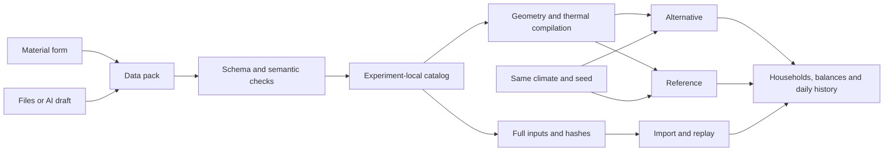
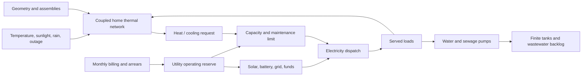

# Warm homes, shared systems

The default game is now a small, moddable **one-year community experiment**. Eight households share heating, electricity, water, sewage and waste services. Change a design, follow a household, compare the same year, then make a reusable mod.

This implements the first proving ground from the [moddability exploration](explorations/0001_[_]_MODDABLE_COMMUNITY_EXPERIMENTS_GROUNDED_IN_PHYSICS_AND_EVIDENCE.md). The broad architecture in that document is a direction, not a list of completed capabilities. The annual lab and the earlier evening game currently have separate model paths.

## First experiment

1. In **Design**, choose **Insulated timber wall** instead of **Light timber wall**.
2. **Run 90 days** to test a winter. Both alternatives advance through identical weather with the same household IDs and seed.
3. In **People**, choose a household or click its home. Read its cold hours, bills, shared operating reserve and maintenance events.
4. Continue with **Run 1 year**. Compare construction, operating cost, unmet water, sewer overflow and unpaid bills as well as comfort.
5. **Try again** returns to the start with your chosen design. Try another plant, a billing policy, a per-home wall, more storage or another settlement.
6. **Workshop** lets you create a material and wall, validate them, and add them to this experiment. Export a mod for reuse or export the whole experiment for a friend.

There is no victory screen. A more comfortable design can still have a funding problem. The loop is to identify a consequence, explain it, change an input and test again. The notebook retains the last six trials **during the current session**. Export trials you want to keep; the notebook itself is not persisted.

**Controls:** drag to pan; wheel, pinch or the ± buttons to zoom; **Turn**, Q or E to rotate. Space pauses/resumes an active run. Phone layouts have a **Scene / Details** button and scrollable panels. Every essential action has an on-screen control. Data entry and comparisons use the same Godot UI on desktop and web.

## What can be composed today?

| Definition | Modifiable data | Boundary |
| --- | --- | --- |
| Materials | Conductivity, density, specific heat, price, embodied carbon, colour, evidence | SI units; material properties do not introduce new equations |
| Wall assemblies | Ordered material layers and thicknesses, labour cost, evidence | Derived resistance, mass, heat capacity, cost and wall carbon |
| Home prototypes | Floor area, width, height, glazing, infiltration, roof/floor U-values, base mass/cost and resource needs | One rectangular, single-level thermal zone per home; one prototype per experiment |
| Layouts | Positions, quarter-turn rotation, ownership, declared supports and party-wall contacts | 3–12 homes; alternatives must retain the same home IDs |
| Climates | Synthetic seasonal profile, cold spell and outage; optional 8,760 hourly records | Non-leap year; prescribed weather, no climate feedback |
| Shared plants | Heat/cooling capacity, efficiency, cost and maintenance schedule | One reversible shared plant; one heating/cooling mode per hour |
| Policies | Equal or proportional capacity allocation; equal or metered grid billing; reserve contribution | Bounded choices in the existing solver, not arbitrary executable rules |
| Evidence | Source, status, geography, period, license and notes | Claims supplied by the author; no automatic source verification |

The bundled layouts are a courtyard, detached cluster and elevated cabins. The independent [hemp example](../mods/lab_hemp/manifest.json) adds a new material and wall without a renderer or simulation branch. Tree support biology, earth-contact construction and rammed-earth moisture behaviour are **not** implemented simply by naming a pack after them.

The visual material editor generates a core layer between two timber skins. For more layers, layouts, plants or policies, edit JSON using the exported schema. Freeform placement, connection/port editing, arbitrary meshes and general-purpose model plugins remain future work.

## Create a mod

In **Workshop**, give your pack a unique lowercase ID, change the physical values and thickness, and select **Create a draft pack**. Review the generated JSON and evidence, then **Validate & add to this experiment**. Pick the new wall in Design. Adding a pack changes only the current experiment, never a global installation. Duplicate namespaces are rejected; make a new namespace for a variation.

A complete minimal assembly pack:

```json
{
  "api_version": 2,
  "model": "warm-homes-1",
  "id": "pine_experiment",
  "name": "Pine wall experiment",
  "version": "1.0.0",
  "dependencies": {"core": "1.0.0"},
  "content": {
    "assemblies": [{
      "id": "pine_experiment:wall",
      "name": "Thicker timber wall",
      "layers": [{"material": "core:timber", "thickness_m": 0.12}],
      "labor_cents_m2": 5000,
      "evidence": "core:assumptions"
    }]
  }
}
```

The `core:assumptions` record labels these values as illustrative. Replace it with your own evidence record when introducing sourced properties. Every cross-pack reference requires an exact declared dependency; IDs are namespaced. Unknown fields, missing references, cyclic dependencies, unsupported model IDs, overlapping homes and invalid physical ranges produce errors before changing the active experiment. Inputs exceeding a declared support capacity or capital budget are rejected atomically.

The authoritative [JSON schema](../schemas/lab-pack.schema.json) is included in builds and can be exported from Workshop. The numeric material form reads its units and bounds from this same schema. The compiler also enforces semantic and geometry constraints that JSON Schema alone cannot express.

**AI workflow:** export the drafting prompt, use it with your preferred assistant, paste the resulting JSON, inspect its assumptions and validate it. No data is sent to a model automatically. The form, file importer and AI-generated JSON all use the same compiler. They cannot add unsupported mechanisms through prose or hidden script entrypoints.

For files authored outside the game:

```sh
python3 scripts/package_mod.py path/to/my_pack
godot --headless --path . --script scripts/run_lab.gd -- \
  --validate-pack=exports/mods/pine_experiment-1.0.0.cbmod.zip
```

For API v2, the packager includes only `manifest.json`. Packaging is not semantic validation; use the command above or the Workshop. API v1 trusted source mods remain supported separately by the [legacy loader](modding.md).

## Ground an experiment in data

Reference weather, material prices, household budgets, occupancy and construction values are **synthetic teaching assumptions**. The release has analytical and accounting checks, but no empirical calibration or independent building-tool comparison. An evidence status of `measured` requires an HTTPS source field; this checks presence, not the truth of the claim.

1. Acquire data with redistribution permission and record the source, location, date, license, units and measurement conditions.
2. Add a separate evidence record for each distinct source/boundary. Use notes for transformations, uncertainty, gaps and price/carbon boundaries.
3. Keep invented values `synthetic`; use `estimated` for unverified or inferred values. Do not promote imported numbers to measured facts automatically.
4. Compare model outcomes against independent observations or analytical cases before describing a pack as calibrated.

**Weather import** accepts a UTF-8 CSV with this exact header:

```csv
hour,temperature_c,solar_w_m2,rain_mm
0,4.2,0,0.1
1,3.9,0,0
```

Supply exactly 8,760 rows, numbered 0–8759, starting January 1 at 00:00 in local standard time. Temperature is °C, solar is the hourly mean irradiance in W/m², and rain is the hourly total in mm. Convert leap years, daylight-saving timestamps and gaps explicitly before import. Do not silently fill missing records. The importer refuses nonfinite/out-of-range values and incomplete years.

Workshop turns the CSV into an editable climate pack with an **unverified evidence record**. Add provenance before installing/sharing it. Then select the imported climate in Design; both alternatives use the same hourly rows. Imported weather has no outage or added cold-spell temperature drop by default; its scenario outage settings can be edited in JSON.

## Sharing, saving and compatibility

**Export experiment** produces a `.cbexperiment.zip` containing only `experiment.json`. It embeds the question, both designs, seed, complete JSON packs, exact pack versions, hashes, model runtime and the recorded hour. A friend imports it from **Compare → Import a friend's experiment** with no editor or manual pack installation.

The hash covers every field in each data manifest, including evidence and hourly weather. There are no external assets to fetch. Import replays the pinned inputs up to the recorded hour; it does not accept imported temperatures, cash balances or claimed results as authoritative state. Runs pause after restoration unless already complete. Unknown model runtimes or mismatched content hashes are rejected, with the active experiment retained.



Autosave writes `user://community-lab.json` every five seconds after changes, at completion and on native suspend/exit. Unreadable or incompatible saves are protected from automatic replacement; **Start fresh** backs up the prior file first. Legacy evening and foundation saves remain separate. There is no silent conversion between their models.

Browser site storage can be cleared or unavailable, so export important experiments. Imports accept bounded JSON or a single-member ZIP: at most 8 MiB, at most 24 JSON nesting levels, no extra members, path traversal, symbolic links, scripts, native libraries, shaders or network assets. Source links are displayed, not fetched. The data runtime does not load external code. This is a deliberately narrow format; public archive fuzzing and broader asset ingestion are still future work.

The replay reference is Godot 4.7.2 with model runtime `warm-homes-1.0.0`. The runtime identifier is maintained by the host and must change for incompatible numerical changes. Cross-platform floating-point bit identity and migration across future engine versions are not promised. Keep the original executable for archival reproduction. Export bundles may contain third-party data: the evidence license is preserved, but redistribution rights are the author's responsibility and are not checked automatically.

## Physics and accounting boundaries

Each home has an air/interior-capacity node and an envelope-mass node. The hourly backward-Euler system solves them together, including party-wall heat exchange. Construction resistance uses `R = 0.17 + sum(thickness / conductivity)` in m²K/W; `U = 1/R`. Layer density and specific heat contribute mass and heat capacity; thickness and price give quantities and costs. Shared walls use the combined resistance of the two adjoining assemblies.



- **Thermal:** heat targets 20°C; cooling targets 26°C. Occupied hours below 18°C and above 28°C are scenario comfort metrics, not health diagnoses. Heat-pump efficiency varies linearly between its cold and nominal values. A shared reversible plant cannot heat and cool simultaneously. The mass node is an approximation; layer order affects authoring, but there is no multi-layer transient or moisture solver.
- **Electricity:** solar, 95%-efficient charging/discharging, finite battery power/capacity and a finite grid connection. Essential base/pump loads have priority. Grid purchases cost €0.35/kWh and need operating cash. Demand that cannot be served remains recorded. These tariffs are illustrative.
- **Water:** finite municipal input and potable storage; roof rain capture with 80% collection efficiency, separate rain storage, rainwater serving at most 30% of demand for flushing. Delivered water becomes 80% wastewater and 20% an explicit external boundary. Pumps depend on available electricity.
- **Sewage:** 1,000 L shared backlog, finite powered removal and explicitly recorded overflow. No pressure, pipe routing, pathogens or downstream contamination model.
- **Waste:** finite bins, litter overflow and paid scheduled collection/cleanup. Material remains in storage, litter or recorded collection.
- **Maintenance:** paid scheduled plant service with downtime and labour; lack of cash delays it. Recorded labour is purchased service time, not simulated resident workforce availability.
- **Money:** integer cents; three property owners with €250,000 initial capital each, a separate €50,000 equipment grant and €5,000 operating reserve. Each household has its own wallet, income, other living expenses, utility bills and arrears. Grid cost is metered or equal; other operating expenses split equally. Property upkeep is a separate outflow. There is no rent negotiation, finance, land market or job market.
- **Support:** total assembly/base mass plus an assumed 150 kg/m² live load must fit declared support capacity. This is a screening condition, not a structural calculation. Elevated supports are declared anchors; no living-tree mechanics, lateral loads or connection failure.
- **Geometry:** authoritative rectangular dimensions determine thermal areas. Decorative paths, people, trees, windows and equipment in the diorama are illustrative and do not add hidden performance bonuses. Roof/floor losses use outdoor air on every layout, including ground layouts. Solar gain uses a fixed projection; no sun/shadow/ground solver.
- **Population:** fixed three-person households and prescribed occupancy/incomes for this year. Names are labels. Births, deaths, family formation, migration, recreation, transit and long-term community evolution are outside this slice.

The annual lab does not run the older sandbox's resource/well-being proxies in parallel. Its data and balances have one owner. Unifying its activity/organization abstractions with the evening scenario is later architectural work.

## Run without rendering

```sh
# Two matched full-year designs; machine-readable results and portable experiment.
godot --headless --path . --script scripts/run_lab.gd -- \
  --assembly=core:warm_wall --hours=8760 \
  --output=artifacts/results.json --save=artifacts/experiment.zip

# Restore/replay the embedded packs, without global mod dependencies.
godot --headless --path . --script scripts/run_lab.gd -- \
  --import=artifacts/experiment.zip --output=artifacts/replayed.json

# A short detached-settlement trial. Use separate invocations for parameter sweeps.
godot --headless --path . --script scripts/run_lab.gd -- \
  --layout=core:cluster --assembly=hemp_lab:wall --hours=168
```

Create the output directory first. `--pack=...` installs a new data pack into a draft. Imported progressed runs are frozen: use a draft to change inputs. Horizons are 168, 2,160 or 8,760 hours. A year stops exactly; the CLI cannot accidentally extend the fixed-population model into a century forecast. Dedicated sensitivity UI, statistical ensembles and multi-year demographic models are not present.

The scene controller caps work at 96 paired hours or approximately 4 ms per frame, whichever is reached first. Physics is independent of visual frame rate. Daily history is bounded to 366 points, events to 160, transfers to 320 and the session notebook to six trials. Replay is incremental in the UI; the headless runner processes continuously.

## Verified implementation checklist

- [x] Data-only schema, namespaces, exact dependencies, semantic validation and embedded content hashes.
- [x] Layer-derived wall physics and construction quantities; courtyard, detached and elevated reference layouts.
- [x] Hourly thermal coupling, constrained power/water/sewage/waste, operating money and maintenance.
- [x] Matched 90-day/year runs, household inspection, comparison chart, undo and session notebook.
- [x] Material/wall authoring form, validated JSON import, independent example pack, evidence inspection and optional AI prompt export.
- [x] Hourly weather CSV adapter and explicit provenance fields.
- [x] Portable experiment replay, bounded archive import and protected older saves.
- [x] Headless runs, pack validation, balance/analytical fixtures and scene tests.
- [ ] Independent thermal-tool comparison and empirical calibration.
- [ ] Novice playtesting, ordinary-browser file-picker coverage and physical mobile performance measurements.
- [ ] General ports/assets/model plugins, freeform architecture and unified social activities.
- [ ] Detailed structural/hazard/soil/moisture models and five-/hundred-year community evolution.

See [builds and validation](validation.md) for the observed checks and platform limits.
