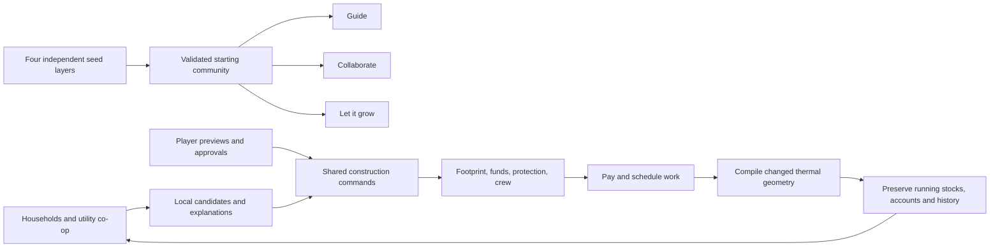

# Living worlds: one seed, three futures

Courtyard Block now starts with a generated community and three simultaneous futures. Build with your neighbours, notice what changes, and try another possibility. This is a bounded, playable first version of procedural co-creation.

## The first five minutes

1. Open **World**. Keep the starting community or browse another seed. Lock any layer you like before rerolling the others.
2. Choose **Guide**, **Collaborate**, or **Let it grow**. These are separate communities that began identically; switching visits another future.
3. Tap a home, or select a household in **Build**. Choose a room edge and dimensions, then **Preview room addition**. A ghost shows the footprint. Confirm to spend the owner's money and book the crew.
4. Press **+1 week**. Residents notice problems and propose or undertake improvements. All three futures advance through the same weather.
5. Read **World → Your neighbours' ideas**, then compare **Futures**. More space may mean higher heating demand. Better utilities consume shared capital. There is no single winning score.

Drag to pan; scroll, pinch or use **+/−** to zoom. **Turn**, Q and E rotate. Space pauses. On phones, **Scene / Details** reveals the scene or its controls.

## What the seed controls

| Layer | What changes | What stays independent |
| --- | --- | --- |
| Layout | Six or eight homes; courtyard rows, garden lanes, or a scattered ring; spacing | Climate and resource draws |
| Climate | Cool/wet, continental or hot/dry seasonal profile; cold spells and outages | Construction decisions |
| Resources | Initial grid, solar, battery, water, sewage and bin capacity | Layout and household preference draws |
| People | Desired space and relative priority for room additions | Initial household count and weather |

Each layer has a visible integer seed. Root seeds derive these with keyed hashes; rerolling a layer preserves locked seeds. Rain and seasonal temperatures depend on the chosen climate family. These starting conditions are **synthetic**, not reconstructed real settlements. The generator is finite and versioned, with many seed combinations rather than an infinite streamed planet.

## Residents as co-builders

| Future | Delegated authority in the reference kit |
| --- | --- |
| Guide | Propose projects; wait for you to approve |
| Collaborate | Automatically undertake projects costing at most €8,000; propose larger ideas |
| Let it grow | Automatically undertake projects costing at most €20,000; propose larger ideas |

Residents examine current comfort and declared space preferences; the utility co-op compares demand with capacity. Once each day they rank a bounded set of possible improvements. Collision checks, owner capital, the co-op grant, a single crew and a 14-day cooldown constrain their choices. These are explicit local heuristics, not an LLM, optimal planning, or a model of cultural behaviour.

Residents can add a 4 × 3 m room, replace a poor envelope, and remove a surplus addition when the home is cold. The co-op can improve water, sewage, waste, solar and battery provision. Players can choose room sizes from 2–8 m per side, replace walls with any installed assembly, remove the latest addition, move an entire home, and install any supported utility recipe. A **protected home** is excluded from autonomous changes; you can still edit it yourself.

Every proposal explains its motivation. The **Workshop journal** records who proposed, started and finished each project. Declining a proposal gives the household a cooldown before reconsidering. A crew handles one project at a time, including demolition and relocation. Approval pays immediately; geometry changes when work finishes. Predictions are uncertain: an agent's explanation is a hypothesis to test, not a guarantee that its action improves everything.



## Real effects, explicit boundaries

Rooms use a metre grid and must touch along an edge. They cannot overlap another home or the reserved utility yard. A home has three permanent base rooms and up to three additions; the engine bounds experiments to 12 homes and 48 rooms. Generated worlds currently have six or eight homes.

The footprint determines floor area, exposed wall edges, roof area and effective thermal capacities. Contact between different homes creates a shared-wall heat link. Each home is one thermal zone with two thermal nodes. A larger room changes the heat calculation and roof rain capture; it does not receive an invented happiness bonus.

Construction retains the running clock, people, occupied comfort hours, debt, maintenance schedule, resource inventories and historical results. New storage capacity arrives empty. Effective thermal capacity added by construction enters at outdoor temperature; removed capacity exports its heat. A wall replacement removes the old wall's effective capacity while retaining the floor's capacity. Results export the construction energy boundary separately.

The room rate covers floor, roof and labor; additional envelope area is priced from the selected wall assembly. These prices include externally supplied materials. There is no local material supply chain, land market, permitting process or construction displacement. Relocation is an illustrative paid operation. The mass ledger covers modeled building materials and excludes the assumed structural live load; it does not include equipment, windows or all life-cycle material flows. The report's `capital_cents` is the currently compiled asset estimate; **construction spent since the start** is a separate cash counter. Operating and household accounts retain the annual lab's [documented assumptions](lab.md#physics-and-accounting-boundaries).

The first release simulates **one year with a fixed household cohort**, not births, migration or centuries. It does not model room-specific plumbing, door access, detailed structure, living trees, terrain, wildfire, floods or empirical social outcomes. People, furniture and paths in the cutaway scene are presentation. Do not interpret synthetic results as building certification or a forecast for a real community.

## Remix without changing engine code

**Workshop** includes the complete living kit as JSON. Change construction costs, durations, space targets, decision weights, cooldowns, delegated budgets and utility recipes. **Validate & start this remix** creates three fresh futures with the same seeds and new rules; it backs up the previous world. The kit is validated against [living-kit.schema.json](../schemas/living-kit.schema.json).

For example, a kit can contain this upgrade recipe:

```json
{"id": "village_water", "name": "Extend the water connection", "field": "water_l_day", "amount": 400, "cost_cents": 150000}
```

Supported recipe fields are `water_l_day`, `sewage_l_day`, `waste_kg`, `solar_kw`, `battery_kwh`, and `tank_l`. Their units follow the field names; all prices are integer cents. Import [API v2 material/assembly packs](data-reference.md) to start a new world with more wall choices. The current resident planner considers the reference insulated wall; players can select any installed assembly. New algorithmic mechanisms still require engine code and tests. Unknown mechanisms are rejected rather than given fictional effects.

**Export AI modding prompt** provides the current kit, schema, constraints and evidence guidance for any assistant. No AI service receives anything automatically. The reference kit is [content/living/kit.json](../content/living/kit.json).

## Keep, share and replay

**Share this world** downloads a ZIP containing pinned input packs, the living kit, four seed layers and player decisions at recorded hours. The input hash identifies the complete inputs. A friend uses **Futures → Import a friend's world** to replay and continue all three futures. Hashes establish identity, not scientific validity or author trust.

Imports validate their structure first, then replay into a separate candidate. The current world remains intact until every recorded action succeeds. Nothing imports arbitrary temperatures, cash or claimed outcomes. The archive reader retains the 8 MiB limit; a world permits at most 512 player decisions. Journals retain the latest 200 events per future. Save replay is pinned to `living-worlds-1.0.0` and generator `living-seeds-1`.

Local autosave uses `living-world.json`; new-world and import actions preserve a timestamped backup. Browser storage is device-local and can be cleared, so export worlds you want to keep. The earlier annual lab, evening game and foundation retain separate saves. Open the annual lab from Workshop, or run `godot --path . -- --lab`.

## Run experiments without rendering

```sh
# Simulate three futures, then package all inputs and decisions.
godot --headless --path . --script scripts/run_living.gd -- \
  --seed=2406 --hours=720 --output=/tmp/futures.json --export=/tmp/world.zip

# Replay exactly the saved hour without advancing it.
godot --headless --path . --script scripts/run_living.gd -- \
  --import=/tmp/world.zip --output=/tmp/replayed.json

# Run a custom kit. Supported durations: 24, 168, 720 or 8760 hours.
godot --headless --path . --script scripts/run_living.gd -- \
  --seed=123 --hours=168 --kit=content/living/kit.json
```

The renderer does not own canonical simulation state. `world_seed.gd` generates inputs; `living_model.gd` compiles room physics; `living_world.gd` handles planning and construction; `world_experiment.gd` advances and replays matched branches. Existing annual replay stays on its original `CBLab` runtime.
