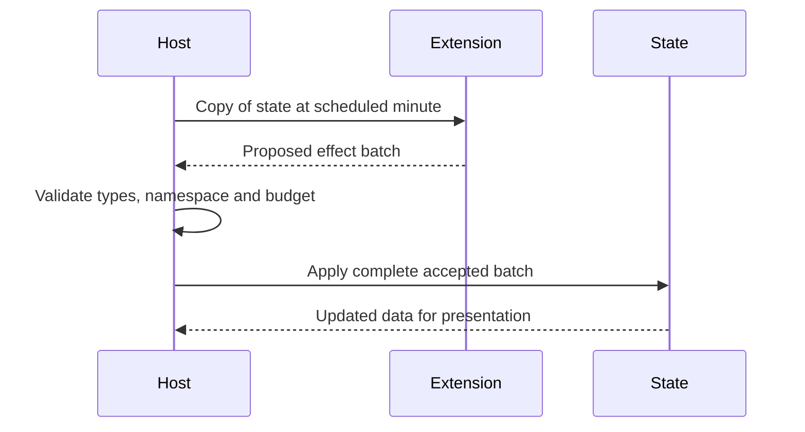

# Modding API v1

For the default annual community lab, use the [API v2 data-mod guide](lab.md#create-a-mod) and [schema](../schemas/lab-pack.schema.json). This page documents the separate **legacy API v1** used by the original sandbox and evening scenario. API v2 packs contain no scripts and are loaded per experiment; the two formats are not interchangeable.

The evening scenario adds validated `evening_services` data. See [the evening guide](evening.md#service-packs-and-the-workshop), `content/evening/manifest.json` and `mods/grocery_pickup/manifest.json`. The latter supplies a working grocery service without an entry script or host-specific callback. Workshop can remix definitions, validate pasted JSON, and export a reusable pack or a drafting prompt for an external AI. New activity types still require engine work; this is not the exploration's full API v2.

The original sandbox can be opened with `--foundation`; it loads the original four bundled packs. The evening scenario adds the two service packs. The following general v1 APIs remain available.

The bundled game uses the same registry as installed packs. Examples:

| Pack | Demonstrates |
| --- | --- |
| `content/base` | Base definitions and courtyard generator |
| `mods/soft_spaces` | A furniture item using JSON only |
| `mods/community_kitchen` | Scheduled behavior, private state and an inspector panel |
| `mods/garden_village` | Alternative spatial generator and independent batched building visuals |

## Make and install a pack

Copy an example into a separate folder, choose a unique lowercase ID, and namespace every definition and hook with `your_pack:`. Do not overwrite base IDs. Package with:

```sh
python3 scripts/package_mod.py /path/to/your_pack
```

The resulting `exports/mods/<id>-<version>.cbmod.zip` has `manifest.json` at its root. Install it through **Mods → Install a trusted mod** and restart. Native installations live in Godot's `user://mods`; browser installations live in that origin's IndexedDB-backed virtual filesystem. Remove a native pack by removing its own folder. Browser removal currently requires clearing site storage after exporting your saves.

Saves require the original pack set. After adding packs, use **Experiments → Start a new community** to play with the new set; the previous save and comparison are kept as timestamped backups. Automatic migration of an existing community to a changed pack set is future work.

GDScript extensions are **trusted code** with the application's capabilities. The archive path checks and API validation are not a sandbox. Installation is limited to 64 MiB compressed, 128 MiB expanded and 2,048 entries; trusted code can still allocate memory or stall a frame. Do not install unknown code. App-store distribution needs a separate code-loading policy review.

```json
{
  "id": "porch_club",
  "name": "Porch club",
  "version": "1.0.0",
  "api_version": 1,
  "dependencies": {"base": "1.0.0"},
  "entry": "entry.gd",
  "content": {
    "furniture": [{"id":"porch_club:seat","name":"Porch seat","cost":8500,"shape":"sofa","benefit":5,"color":"#879a79"}]
  }
}
```

`entry` is optional. Dependencies use exact versions. Missing/incompatible dependencies, cycles, duplicate IDs and malformed definitions are reported before a usable catalogue is activated. A failing pack's registrations roll back. Runtime pack changes require restarting. Saves pin the exact pack set, versions and SHA-256 fingerprints of manifests and entry scripts. In v1 keep behavior in the entry script: helper/asset files are not yet part of that fingerprint.

## Registration

An entry script extends `RefCounted` and exposes `register(catalog: CBCatalog)`.

```gdscript
extends RefCounted

func register(catalog: CBCatalog) -> void:
    catalog.register_system("porch_club:greetings", greetings, 60)
    catalog.register_panel("porch_club:summary", summary)

func greetings(snapshot: Dictionary) -> Array:
    if int(snapshot.minute) % 1440 != 19 * 60:
        return []
    return [{"type": "notice", "text": "An evening on the porch."}]

func summary(_snapshot: Dictionary) -> Dictionary:
    return {"title": "Porch club", "text": "Neighbours meet at seven."}
```

| API | Contract |
| --- | --- |
| `register_content(kind, definition)` | Namespaced ID and name; see examples for required furniture, material and business fields |
| `register_generator(id, callback)` | Parameters → serializable layout |
| `register_visual(template_id, callback)` | Layout and parameters → primitive array, evaluated only on rebuild |
| `register_system(id, callback, interval_minutes)` | Snapshot → effect array; interval must be divisible by 15 |
| `register_panel(id, callback)` | Snapshot → `{title, text}` |

Systems execute in ID order after resident updates, before daily settlement. They receive independent copies; mutating a snapshot cannot change the canonical state. Effects are validated as a batch and spending reserved before application. Supported effects are `spend {amount,reason}`, `need {resident,need,amount}`, `mod_state {id,value}`, and `notice {text}`. Amounts of money are integer cents. Private state belongs under your pack namespace and must be JSON-serializable. New gameplay data may be stored there; adding entirely new core need dimensions or activity planners is not part of API v1.



## Generators and visuals

See the complete garden-village example. A layout has `kind`, `width`, `courtyard`, `floors`, `points`, `edges`, and `spaces`. Points have numeric IDs and `[x,y,z]` positions. Edges contain pairs of point IDs. Spaces include `id`, `name`, `kind`, `node`, `floor`, `position`, `[width,depth]` size, capacity, and a furniture array. Provide homes, a shared space named `courtyard`, and an external destination named `city`. Everything must be connected. A rebuild must provide a distinct home for each existing household; it preserves people, household balances and furnishings, or rejects the command before charging.

Visual callbacks return primitives such as:

```gdscript
{"shape": "box", "position": [0, 1, 0], "size": [4, 2, 4],
 "color": "#d4b38f", "floor": 0, "wall": true}
```

Shapes are `box`, `sphere`, or `cylinder`. Wall primitives disappear on the selected cutaway floor. The renderer batches matching floor/color/shape/wall entries; use a small reusable palette. There is a 100,000-primitive ingestion limit, not a performance guarantee. Custom imported meshes, arbitrary UI scenes and physics-heavy script mods require future API work.

Furniture currently uses `bed`, `sofa`, `plant`, `shelf` and `table` shapes; other shape names fall back to a table. Placement uses 12 deterministic furnishing slots per apartment. The catalogue has no fixed entry limit; the searchable menu displays at most 40 matching entries at once. Installed content still consumes memory, so “unlimited” means extensible rather than literally infinite.
