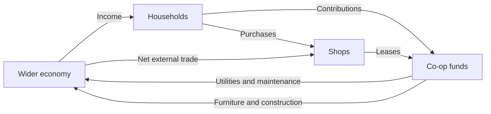

# Simulation assumptions

This page describes the original `--foundation` sandbox. The default playable evening has real stocked food services, minute-resolved activities, utility capacities and shift accounting; see its [separate model description](evening.md). The two modes use separate saves and do not silently convert one model into the other.

The model supports repeatable gameplay experiments. It does not establish that a courtyard, any settlement form or any policy is objectively optimal. Compare individual residents and the least-happy 10% alongside the mean.

## Inputs and provenance

| Parameter | Default | Interpretation |
| --- | --- | --- |
| Water demand | 130 L/person/day | Vienna's published average; a benchmark, not a universal rate |
| Household contribution | €900/month | Synthetic balancing choice; not Vienna market rent |
| Resident income | €1,800–3,599.99/month | Seeded synthetic range; no demographic claim |
| Starting co-op funds | €250,000 | Synthetic experiment budget |
| Starting household wallet | €3,500 | Synthetic liquidity |
| Shop lease | €25/day | Synthetic balancing choice |
| Power | 4.5 kWh/person/day | Synthetic simplified demand |
| Waste | 0.8 kg/person/day | Synthetic simplified demand |
| Water/sewage charge | €0.005/L combined | Synthetic operating-cost proxy |
| Electricity charge | €0.28/kWh | Synthetic operating-cost proxy |
| Waste charge | €0.18/kg | Synthetic operating-cost proxy |
| Maintenance | €1.25/household/day × material factor | Synthetic operating cost |

[Vienna water information](https://www.wien.gv.at/umwelt/eu-trinkwasserrichtlinie) supplies the water benchmark. [Statistics Austria's housing-cost series](https://www.statistik.at/en/statistics/population-and-society/housing/housing-costs) is a reference for future calibration; market rent, cooperative contributions, acquisition cost, financing and operating costs are different quantities and are not substituted for one another here. The current release does not contain a calibrated housing finance model or a live data feed.

## Time, people and money

The canonical clock advances in 15-minute ticks. A deterministic integer random sequence assigns names, interests, skills, income and preferences. State, time, random sequence, pack fingerprints and mod state persist in JSON at full numeric precision. Replaying the same saved state and commands yields the same outcomes; trusted extensions must avoid wall-clock time and unseeded randomness to preserve this property.

Households have two to four people depending on available homes. Residents rest, work, shop and socialize according to fixed daily schedules. Routing uses the generated connected graph, 50 metres/minute walking and a minimum one-tick journey. Visual motion interpolates between route points and is not authoritative. Some people work in occupied shops; the rest work in the wider city. Skills and interests are inspectable traits; they do not yet drive employment matching. Preferences affect social weighting and affordability uses household income.

Shopping transfers €6 from a household to a local shop, or to the external economy when no grocer is present. Daily wages enter household wallets from the external economy; household contributions move to the co-op, and unpaid contributions become arrears. Businesses receive synthetic external trade net of operating costs, then pay a lease from their wallet. Utilities and maintenance debit the co-op. The ledger records co-op flows. There is no closed-world conservation claim: wages, external trade, groceries and service providers cross the modeled boundary. Unlimited mode records explicit experiment grants.

Food, rest, social connection and comfort contribute to well-being. Furniture currently adds comfort regardless of its descriptive `need` field. Utilities share a financial reliability model: insufficient funds reduce service quality, reducing comfort; restoration costs €2,500. Water, power and waste accumulate daily. Pipe routing, storage inventories, physical utility throughput, detailed sewage engineering, construction labor and real housing debt are future simulation systems.

## Comparisons and limits

Forks deep-copy state and record a common origin. Comparison uses the latest hour both branches have reached, within 90 days of retained hourly history. Values include mean well-being, bottom decile, funds and cumulative resource use. Change one thing at a time and keep the seed and pack set fixed. Long-term behavior, causal validity, demographic realism and market equilibrium have not been established.
