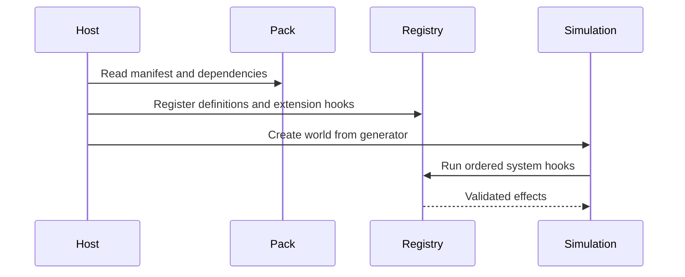

# 01 — Foundation and extension API

Create a typed, scene-independent simulation with seeded outcomes. Namespaced definitions describe furniture, materials, businesses, activities, and templates. Generators return spaces and connectivity; scheduled systems return effects applied by the host. The bundled game follows the same registration API as mods.

- [ ] Implement registries and useful validation errors
- [ ] Implement portable saves with pack fingerprints and explicit mod state
- [ ] Provide trusted GDScript mod templates and packaging tools
- [ ] Test duplicate IDs, dependency cycles, missing packs, and repeatable execution

Keep gameplay state in plain serializable values; display nodes are projections. Reject malformed data before activating a pack. Trusted scripts have the application's capabilities and are not sandboxed.
