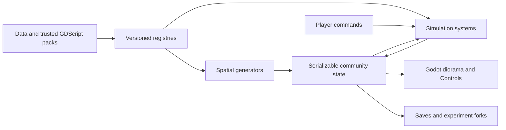

# Courtyard Block: Godot foundation

Build a warm, moddable community simulation using Godot 4.7.2, typed GDScript, and Compatibility rendering. Desktop, browser, Android, and iOS development builds are targets. The starting workspace was empty. The courtyard is an experiment, not a prescribed optimum.

## Architecture

## Sequence

1. [Foundation and extension API](01-foundation.md)
2. [Playable community](02-community.md)
3. [Platform and performance validation](03-validation.md)

## Implementation checklist

- [ ] Registry, dependency validation, and runtime trusted mod loading
- [ ] Parametric courtyard, resident routing, and repeatable simulation
- [ ] Co-op economy, utilities, businesses, furnishing, and resident inspection
- [ ] Warm diorama, floor cutaways, desktop and touch interaction
- [ ] Save/resume, import/export, experiment forks, and comparisons
- [ ] Furniture, community-kitchen, and alternative-settlement example mods
- [ ] SDK, economic assumptions, and export documentation

## Validation checklist

- [ ] Headless integration and invariant tests
- [ ] Native rendered smoke test and benchmark
- [ ] Browser export and interaction smoke test
- [ ] Android development export and emulator smoke test
- [ ] iOS development export and simulator smoke test
- [ ] Physical iPhone 13/Pixel 7-class sustained 60 fps validation

Performance acceptance: 150 residents, a seven-storey building, 5,000 placed objects, and a 10,000-item catalogue. Target 60 fps; report actual measurements and unresolved hardware checks. Simulator success is not evidence of phone GPU or thermal performance. Trusted code mods cannot carry an unconditional performance or isolation guarantee.

Multiplayer, a marketplace, public app-store distribution, and arbitrary freeform building are outside this first foundation. Runtime mod changes require a restart. Missing save dependencies must be reported without discarding the save.

## References

- [Godot web export constraints](https://docs.godotengine.org/en/stable/tutorials/export/exporting_for_web.html)
- [Resource packs](https://docs.godotengine.org/en/stable/tutorials/export/exporting_pcks.html)
- [Runtime file loading](https://docs.godotengine.org/en/stable/tutorials/io/runtime_file_loading_and_saving.html)
- [MultiMesh](https://docs.godotengine.org/en/stable/tutorials/performance/using_multimesh.html)
- [Statistics Austria housing costs](https://www.statistik.at/en/statistics/population-and-society/housing/housing-costs)
- [Vienna water consumption](https://www.wien.gv.at/umwelt/eu-trinkwasserrichtlinie)
