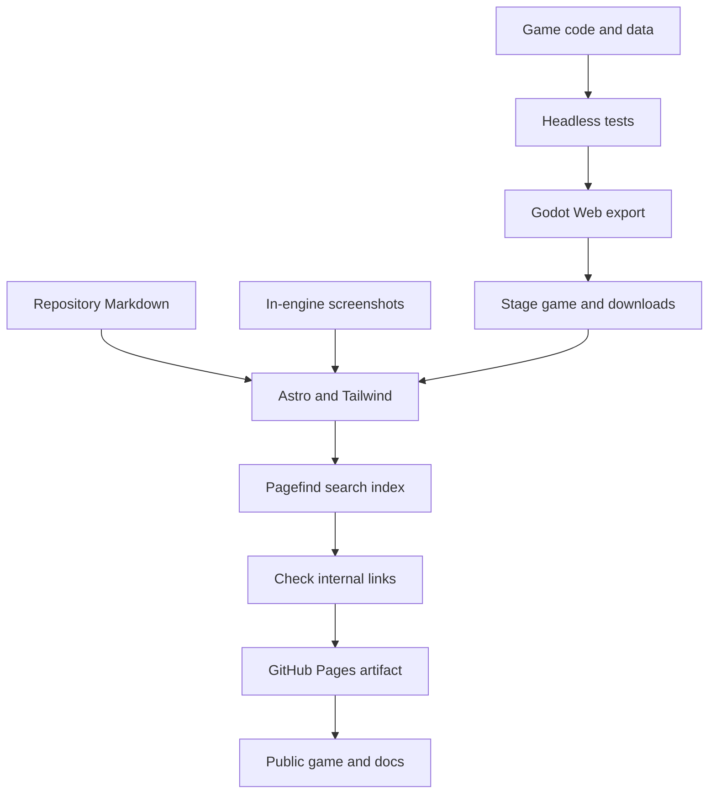

# Website and publishing

The public website is **[crs48.github.io/courtyard-block](https://crs48.github.io/courtyard-block/)**. It contains a static Astro landing page, searchable documentation, downloadable mod examples and the Godot browser game. Tailwind CSS handles the website's styling; the playable simulation remains in Godot.

## Build locally

Install Godot **4.7.2**, its matching export templates, Python 3 and Node **24**. From the repository root:

```sh
npm ci --prefix website
python3 scripts/check.py
python3 scripts/build_web.py
npm run check --prefix website
npm run build --prefix website
npm run preview --prefix website
```

Open `http://localhost:4321/courtyard-block/`. Preview serves the complete built site, including search and the playable game. `npm run dev --prefix website` gives live website updates, but search needs a production build first.

The build requires a browser export in `exports/web/`. It stages the game, the engine's own license notices, the schema and sample mod into `website/public/`, builds static HTML, indexes the docs with Pagefind, and checks local links. Generated output, dependencies and game binaries stay out of Git.



## Automatic publishing

The [Pages workflow](../.github/workflows/pages.yml) runs on pull requests, pushes to `main` and manual dispatch. It downloads the pinned Godot release and matching templates from the official project, verifies their published SHA-512 checksums, and caches them. Node dependencies use the committed lockfile.

Only successful builds on `main` deploy, through the `github-pages` environment. The repository uses GitHub Pages' **GitHub Actions** source. No personal access token or additional deployment secret is required by the workflow.

The public path is configured in [astro.config.mjs](../website/astro.config.mjs): `site` is `https://crs48.github.io` and `base` is `/courtyard-block`. All navigation, game and search URLs include this base path. Change both settings and the repository links if deploying a fork elsewhere.

The Godot Web preset uses single-threaded WebAssembly and Compatibility rendering. It does not require cross-origin isolation headers. The game is loaded on the Play page, so visiting documentation does not download its WebAssembly binary. Browser/device support and physical-mobile testing limits are documented in [builds and validation](validation.md).

## Documentation and artwork

`website/src/lib/docs.ts` maps canonical Markdown documents to public URLs. Relative links to published documents become website links; links to source code go to GitHub. Mermaid diagrams render in documentation, with their source retained as a fallback. Pagefind indexes the documentation locally, without a hosted search service.

The landing-page images come from the actual game. To regenerate them with a graphical Godot installation:

```sh
godot --path . --script scripts/capture_site.gd -- --lab-test
```

The `--lab-test` flag avoids loading or overwriting a player's saved community. The website directory has `.gdignore` so Godot does not scan Node dependencies or ship the website inside the game.

See the official guides for [Astro on GitHub Pages](https://docs.astro.build/en/guides/deploy/github/), [Tailwind with Astro](https://tailwindcss.com/docs/installation/framework-guides/astro) and [GitHub Pages custom workflows](https://docs.github.com/en/pages/getting-started-with-github-pages/using-custom-workflows-with-github-pages).
